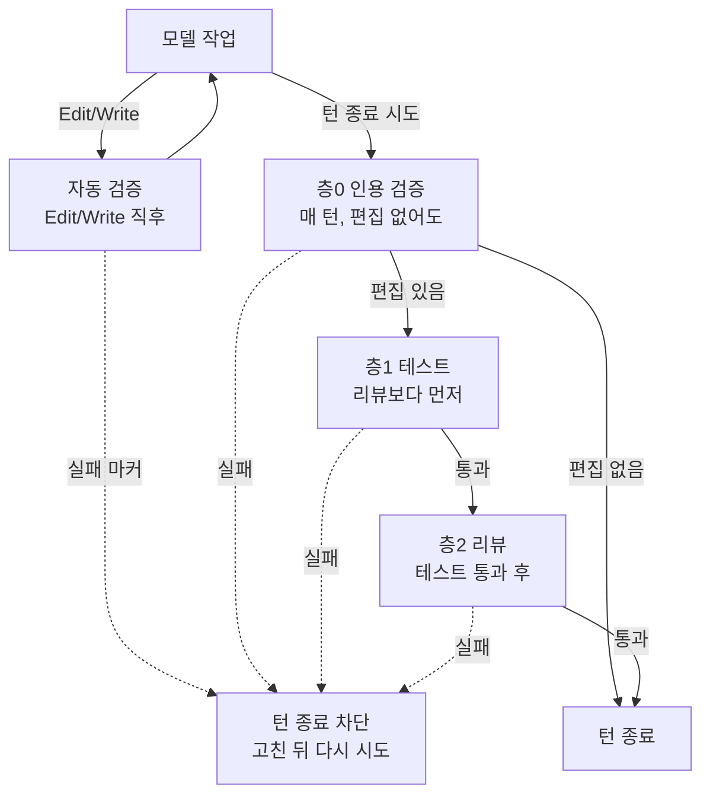

<div align="center">

# Good Boy

> 세상에 나쁜 AI는 없다 — There Are No Bad Agents

Claude Code 등 agentic LLM-CLI 환경에서 LLM의 약점(컨텍스트 오염·환각·부족한 프롬프트·검증 부재)과 토큰 낭비를 hook + skill 조합으로 결정적으로 억제하는 가드레일 레이어.

[](package.json)
[](LICENSE)


[설치](#설치) · [사용법](#사용법) · [검증 4층](#검증-4층) · [버전별 개선 이력](#버전별-개선-이력) · [트러블슈팅](#트러블슈팅)

</div>

## 목차

- [핵심 원칙](#핵심-원칙)
- [어떤 문제를 푸나](#어떤-문제를-푸나)
- [한눈에 보기](#한눈에-보기)
- [설치](#설치)
- [사용법](#사용법)
- [층0 인용 검증](#층0-인용-검증)
- [결정 근거 기록 (4분류)](#결정-근거-기록-4분류)
- [위험도 게이트](#위험도-게이트)
- [설치 범위와 전환](#설치-범위와-전환)
- [컨텍스트 자동 관리 (auto-compact)](#컨텍스트-자동-관리-auto-compact)
- [상태바 (선택 설치)](#상태바-선택-설치)
- [계측 (게이트 무력화 감지)](#계측-게이트-무력화-감지)
- [디렉터리 구조](#디렉터리-구조)
- [층1 테스트 게이트](#층1-테스트-게이트)
- [층2 리뷰 — 크기에 맞춰 (v0.32.0, 트랙 H7)](#층2-리뷰--크기에-맞춰-v0320-트랙-h7)
- [트러블슈팅](#트러블슈팅)
- [버전별 개선 이력](#버전별-개선-이력)
- [개발 상태](#개발-상태)
- [라이센스](#라이센스)
- [기여](#기여)

## 핵심 원칙

- **결정성은 hook으로** — 모델 판단에 맡기지 않고 hook 7종(SessionStart / PreToolUse / PostToolUse / PostToolUseFailure / UserPromptSubmit / Stop / SubagentStop)으로 강제
- **결정 근거 기록** — 사실 / 판단 / 가정 / 추측 4분류로 결론과 근거를 작업 전에 짧게 요약 (기본은 권장 + 1회 안내, `GOODBOY_REASONING_GATE=deny`면 차단 강제)
- **검증된 방법만** — 변경 후 별도 서브에이전트가 리뷰하고 구조화 JSON으로 결과 반환
- **사용자 결정권 보존** — 위험 작업은 명시적 승인 마커 없이 진행 불가

## 어떤 문제를 푸나

LLM이 코드 작성 시 자주 발생하는 4가지 약점과 Good Boy의 해결책:

1. **컨텍스트 오염** → 넓게 훑는 탐색 도구를 서브에이전트로 위임 강제 (PreToolUse hook)
2. **환각** → 결정 근거 기록(4분류) + Read-before-edit + 자동 검증 + 리뷰 강제
3. **부족한 프롬프트** → 카테고리별 필수요소 사전 검증 + "확인 필요" 답변 허용
4. **검증 부재** → 별도 서브에이전트가 리뷰 후 구조화 JSON 결과 → Stop hook이 통과/차단 결정

## 한눈에 보기

| 기능 | 하는 일 | 자세히 |
|---|---|---|
| 카테고리 커맨드 | `/fix-bug`, `/add-feature` 등 7개 작업 카테고리를 필수 입력 점검과 함께 실행한다 | [카테고리 슬래시 커맨드](#카테고리-슬래시-커맨드) |
| 층0 인용 검증 | 답변에 인용한 `파일:줄`이 실재하는지, 이 세션에서 읽은 파일인지 매 턴 확인한다 | [층0 인용 검증](#층0-인용-검증) |
| 자동 검증 | Edit/Write 직후 타입체크를 돌리고, 실패가 남아 있으면 턴 종료를 막는다 | [검증 4층](#검증-4층) |
| 층1 테스트 게이트 | 변경된 코드가 실제로 동작하고 요구사항을 만족하는지 실행으로 확인한다(red-green, 뮤테이션 프로브) | [층1 테스트 게이트](#층1-테스트-게이트) |
| 층2 리뷰 | 테스트 통과 후 별도 서브에이전트가 환각·리팩토링·보안·성능·UI 축으로 리뷰한다 | [층2 리뷰](#층2-리뷰--크기에-맞춰-v0320-트랙-h7) |
| 결정 근거 기록 | 작업 전에 `## 근거` 섹션에 사실/판단/가정/추측 4분류로 결론과 근거를 요약한다 | [결정 근거 기록](#결정-근거-기록-4분류) |
| 도구 위임 | 넓게 훑는 탐색 도구(WebSearch/WebFetch/Grep/Glob)는 서브에이전트로 위임한다 | [도구 위임](#도구-위임) |
| 규칙과 역할 | 게이트는 근거가 있을 때만 통과하고, 근거 없이 넘어가는 것은 사용자만 할 수 있다. 에이전트 24개 | [규칙과 역할](#규칙과-역할-v0310-트랙-g) |
| 프로젝트 지식·모드 | `.goodboy/policy.md`·`.goodboy/docs.json`을 세션 시작 때 먼저 읽게 하고, 비프로젝트 폴더는 테스트 게이트를 끈다 | [프로젝트 지식 파일](#프로젝트-지식-파일과-읽기-게이트-v0320-트랙-h) |
| 위험도 게이트 | 위험(risky) 작업은 사용자가 직접 만든 승인 마커가 있어야 진행한다 | [위험도 게이트](#위험도-게이트) |
| 컨텍스트 자동 관리 | 매 턴 컨텍스트 점유율을 계산해 30%부터 경고하고, 50% 이상이면 `/compact`를 권한다 | [컨텍스트 자동 관리](#컨텍스트-자동-관리-auto-compact) |
| 토큰 낭비 게이트 | 같은 파일 재-Read, 출력 홍수, Bash 재귀 탐색, 웹 재페치 같은 습관을 막거나 경고한다 | [토큰 낭비 게이트](#토큰-낭비-게이트-tokenhabit-카탈로그-기반) |
| 상태바 | 컨텍스트 %, 카테고리·위험도, 리뷰 대기, 검증 실패, 게이트 차단 수를 표시한다(선택 설치) | [상태바](#상태바-선택-설치) |
| 계측 | 게이트의 deny/warn/판단불가를 `gate-log.jsonl`에 남기고, 측정이 연속 실패하면 경고한다 | [계측](#계측-게이트-무력화-감지) |

## 설치

### Marketplace 설치 (권장)

```bash
/plugin marketplace add yolol312/goodboy
/plugin install goodboy@goodboy --scope project   # 또는 user | local. 기본은 user(글로벌)
```

설치 범위(user/project/local/session)와 이미 설치된 플러그인의 범위 전환은
[설치 범위와 전환](#설치-범위와-전환)을 참고하세요.

### 로컬 개발 모드 (플러그인 자체를 수정할 때)

```bash
claude --plugin-dir /path/to/goodboy
```

### 요구사항

- Claude Code v2.1.138+
- Bun (hook과 CLI 런타임) — **미리 설치할 필요는 없습니다.** 첫 프롬프트에서 자동 설치를
  안내하고, 프롬프트를 한 번 더 입력하면 플러그인 전용 폴더(`~/.claude/goodboy-runtime`)에
  자동 설치됩니다(시스템 전역을 건드리지 않음). 자세한 동작은
  [트러블슈팅 > "Bun 런타임이 필요합니다"](#bun-런타임이-필요합니다-라며-차단됩니다) 참고.
- **macOS / 리눅스**: 추가 요구사항 없음.
- **Windows**: [Git for Windows](https://git-scm.com/downloads/win) **필수** —
  아래 [Windows 지원](#windows-지원) 참고.

### Windows 지원

Claude Code는 Windows 네이티브에서 hook 명령을 **Git Bash가 설치돼 있으면 Git Bash로,
없으면 PowerShell로** 실행합니다. goodboy의 hook 런처(`bin/goodboy-run.sh`)와 Bash 게이트는
POSIX 셸을 전제하므로 **Git for Windows 설치가 필수**입니다. 이는 Claude Code가 Bash 도구를
쓰기 위해 권장하는 구성과 동일합니다.

| 환경 | 동작 |
|---|---|
| macOS / 리눅스 | 전 기능 |
| Windows + Git for Windows | 전 기능 (Bun 자동 설치는 Git Bash에 `unzip`이 없어 실패할 수 있음 → `powershell -c "irm bun.sh/install.ps1 \| iex"` 안내로 폴백) |
| Windows, Git Bash 없음 | **미지원.** hook이 PowerShell로 실행되어 런처가 뜨지 않고, 안전장치 전체가 동작하지 않습니다 |

알려진 공백: Git Bash가 없는 Windows에서 Claude Code는 Bash 도구 대신 PowerShell 도구를
사용합니다. goodboy의 토큰 낭비 게이트 중 Bash 명령을 검사하는 항목(재귀 탐색 차단,
대용량 출력 차단)은 PowerShell 도구 호출에는 적용되지 않습니다.

## 사용법

### 카테고리 슬래시 커맨드

7개 카테고리:

- `/fix-bug <설명>` — 버그 수정 (effort high)
- `/add-feature <설명>` — 기능 추가 (effort high)
- `/refactor-code <설명>` — 리팩토링 (effort high, 구 `/refactor`)
- `/prepare-migration <설명>` — 마이그레이션 준비: 작성·롤백·로컬 dry run까지, 공유·운영 환경 적용은 사용자가 직접 (위험도: 위험, effort xhigh, 구 `/migrate`)
- `/diagnose-failure <증상>` — 원인 진단, 수정은 `/fix-bug`로 (effort high, 구 `/debug`)
- `/write-doc <주제>` — 문서 작성 (effort medium)
- `/request-review <기준>` — 리뷰 요청 (effort low)

각 스킬은 적힌 effort로 그 턴만 실행된다(끝나면 원래 설정). 각 카테고리에 위험도 override 가능: `/fix-bug --risk risky <설명>`

### 일반 프롬프트의 부족-입력 질문 유도 (B2)

슬래시 커맨드 없이 자연어로 요청해도, 매 프롬프트에 self-assessment 지시가 주입된다:
착수에 필요한 핵심 정보(대상/기대 동작/재현 방법 등)가 부족하면 **지어내지 말고
AskUserQuestion으로 묶어 질문**하고, 답 없는 항목은 `## 근거 > 가정`에 기록하라는 규칙.
충분한지의 판단은 모델이 하지만, 묻지 않고 가정으로 진행하면 근거 게이트(A1)와
추측-리뷰 연동(A2)이 그 가정의 기록·검증을 강제한다. 끄기: `GOODBOY_ASK_UNCLEAR=off`

### 동작 흐름 (예: /fix-bug)

<details>
<summary>단계별 흐름 펼쳐 보기</summary>

```
사용자: /fix-bug 로그인 후 401 떨어짐
   ↓
UserPromptSubmit hook:
   - 인자가 아예 없으면(/fix-bug만) 차단하고 필수 질문 목록 안내 (결정적 차단)
   - 인자가 있으면 필수 입력 체크리스트를 모델에게 주입 → 모델이 자기점검(self-assessment)
     후 실제로 부족한 항목만 AskUserQuestion으로 질문 ("확인 필요" 옵션 포함)
   ↓
모델: ## 근거 섹션에 결정 근거 요약 (사실/판단/가정/추측 4분류) — 기본은 권장(없거나 비면 1회 안내),
      GOODBOY_REASONING_GATE=deny면 필수 + 내용까지 검사(빈 섹션 차단)
   ↓
위험도 게이트 (PreToolUse hook): 위험도 risky면 사용자 승인 마커 확인
   ↓
모델 작업: Read → Edit/Write
   - Read-before-edit hook이 Edit/Write 시 같은 파일 Read 이력 검증
   - 근거 게이트가 ## 근거 섹션 존재 + 실질 내용 검사 (기본 warn=안내만, deny=차단, off=검사 안 함)
   ↓
PostToolUse hook이 자동 검증 실행 — 기본은 타입체크만 (GOODBOY_AUTOVALIDATE=all이면
린트/테스트까지). 실패 시 실패 마커를 남기고, 마커가 해소될 때까지 Stop hook이
턴 종료를 차단한다(재검증 통과 시 자동 해제).
   ↓
모델이 작업 완료 시도 → Stop hook 층1 **테스트 게이트** (리뷰보다 먼저)
   - 없음 → 차단, "goodboy:test-unit 서브에이전트를 부르세요"
   ↓
test-unit 서브에이전트가 동작을 검증
   - 컨테이너(docker compose)로 서버/DB 기동 → 단위·통합·E2E(Playwright) 작성·실행
   - dev-cycle 프로토타입이 있으면 **정답지로 대조** (구조·능력·상태, 픽셀 아님)
   - red-green + 뮤테이션 프로브로 "통과하지만 아무것도 검증하지 않는 테스트" 배제
   → .claude/tests/<ts>.json 작성. 테스트 파일 자체는 repo에 남는다
   ↓
Stop hook 재검사(층1): 스위트 실패 0 / test_files 실재 / red가 실패했는지 /
   UI 기준의 뮤테이션 감지 / 수용 기준 커버리지 / 가짜 테스트 패턴 → 하나라도 미달이면 차단
   ↓
모델이 다시 완료 시도 → Stop hook 층2 **리뷰 게이트**
   - 리뷰 대상 = 마지막 리뷰 이후 **메인이 편집한** 파일 (서브에이전트가 만든 프로브/임시
     파일은 대상 아님 — 리뷰 에이전트가 자기 프로브 파일 때문에 다시 차단되는 자기참조
     루프를 막는다)
   - 없음 → 차단, "goodboy:review-all 서브에이전트를 부르세요"
   ↓
review-all 서브에이전트 호출: 작은 변경(200줄 이하)은 **1개가 모든 축**, 큰 변경은 **축별로 병렬**
   hallucination(항상) · refactoring · security · performance · ui
   → 각 리뷰가 .claude/reviews/<ts>.json 작성. Stop이 합집합으로 커버리지 판정
   → 리뷰 뒤 고친 파일만 남았으면 그 파일만 보는 **delta 리뷰**(`mode: delta`)로 충분
   ↓
Stop hook 재검사(층2):
   - verdict=pass → 통과
   - high severity finding → 자동 수정 시도 (재시도 3회 cap)
   - ## 근거 섹션에 추측/가정을 선언했는데 리뷰가 가정 검증을 안 했으면 → 차단
   - 필수 차원 누락 → 차단
   - medium/low → 사용자에게 표시 후 결정 위임
```

</details>

### 검증 4층



| 층 | 언제 | 무엇을 묻나 | 산출물 |
|---|---|---|---|
| **층0 인용 검증** | **매 턴 (편집 없어도)** | 인용한 `파일:줄`이 실재하는가 · 실제로 읽었는가 | (없음, 기계 판정) |
| **자동 검증** | Edit/Write 직후 | 타입이 맞는가 | (마커) |
| **층1 테스트** | 턴 종료 시, 리뷰보다 먼저 | **동작하는가 · 요구를 만족하는가** | `.claude/tests/*.json` + repo의 테스트 파일 |
| **층2 리뷰** | 테스트 통과 후 | 환각 · 리팩토링 · 성능 · 보안 | `.claude/reviews/*.json` |

순서가 뒤집히면 안 된다 — 리뷰(리팩토링·성능·보안)는 "동작은 맞다"를 전제로 하는 검토다.

## 층0 인용 검증

다른 모든 게이트는 **편집이 있을 때만** 발동한다. 그래서 코드베이스를 설명만 하는 답변 턴은
통째로 무검증이었다 — `파일:줄`을 대고 단정해도 아무도 확인하지 않았다. 층0이 그 구멍을 메운다.

| 검사 | 위반 시 |
|---|---|
| 인용한 파일이 실재하는가 | **확정 환각** → 즉시 차단, 정정 요구 |
| 인용한 줄이 파일 길이 안인가 | **확정 환각** → 즉시 차단 |
| 그 파일을 이 세션에서 읽었는가 | 근거 미확인 → 차단. 반복되면 `hallucination` 축 리뷰로 승격 |

**오탐을 막는 설계**가 핵심이다. 이 게이트는 모든 턴에 발동하므로 오탐이 잦으면 통째로 꺼진다:

- **`파일:줄` 형식만** 인용으로 본다. 백틱 경로 단순 언급(`` `package.json` ``)이나 URL, 버전
  문자열은 건드리지 않는다
- 줄 번호는 **파일 길이 초과**만 본다(내용 일치까지 보지 않음 — 편집으로 줄이 밀리는 것은 정상)
- **읽기 기록이 통째로 없으면 판정을 생략**한다 — 압축(compact) 직후에는 기록이 비므로

이 게이트가 성립하려면 **Bash 읽기 추적**이 필요하다. bypass permissions 모드에서는 시스템이
"파일은 `cat`/`sed -n`으로 읽어라"라고 지시하는데, 예전에는 `Read` 도구만 기록해서 정직하게
읽은 세션조차 읽기 이력이 0이었다. 이제 `cat`/`head`/`tail`/`sed -n`/`bat`/`less` 로 읽은
프로젝트 파일도 읽기로 기록한다(`grep`/`rg`는 제외 — 검색은 "그 파일을 봤다"는 증거가 아니다).

### 판정 대상은 "이번 턴의 답변"이다

Stop 훅은 이번 턴의 답변이 transcript에 기록되기 **전에** 실행될 수 있다(실측 130ms 차).
그대로 두면 게이트가 판정 대상을 못 보고 환각을 통째로 놓치거나, 반대로 **직전 턴 답변**을
판정해 이미 정정한 주장을 재차단한다. 그래서:

- 마지막 사용자 프롬프트 뒤에 답변 텍스트가 있어야 판정한다
- 없으면 최대 3초 폴링한다 (`GOODBOY_CLAIM_FLUSH_WAIT_MS`, 상한 8초)
- 사용자 프롬프트 자체가 없는 transcript는 기다리지 않고 건너뛴다
- 끝내 안 보이면 판정하지 않는다 — 정정된 주장을 재차단하는 쪽이 미검출보다 나쁘다

### 훅 발화는 사용자 발화가 아니다

하니스는 차단 사유를 *user* 엔트리로 되먹인다. 그 사유에는 문제의 인용이 그대로 들어 있어서,
"사용자가 먼저 쓴 인용은 모델 주장이 아니다" 규칙에 걸려 **첫 차단 이후 같은 환각이 영구
면역**됐다(실측). 이제 모든 차단 메시지에 `[goodboy 훅]` 출처가 붙고, 층0은 그 표식이 붙은
발화를 사용자 발화로 세지 않는다. 같은 표식이 **서브에이전트가 게이트 메시지를 프롬프트
인젝션으로 오인해 무시하던 문제**도 함께 막는다.

끄기: `GOODBOY_CLAIM_GATE=off`

### 도구 위임

탐색 도구는 서브에이전트로 강제 위임하고, 콕 집어 읽기·고치기·판단은 메인이 직접 한다.
한 줄로: **"넓게 훑기는 서브에, 콕 집어 읽기·고치기는 메인에."**

| 동작 | 도구 | 수행 주체 |
|---|---|---|
| 넓게 훑기 (강제 위임) | WebSearch / WebFetch / Grep / Glob | 서브에이전트 |
| 콕 집어 읽기 | Read | 메인 |
| 편집·판단 | Edit / Write / 그 외 | 메인 |

PreToolUse hook이 메인에서 탐색 도구 4종 호출을 차단하고 서브에이전트 위임을 유도한다.
(서브에이전트 내부에서는 면제 — 서브가 직접 Grep/Glob 등을 쓴다.)

위임 강제 비활성화 (디버깅용): `GOODBOY_DISABLE_DELEGATION=1`

### 토큰 낭비 게이트 (tokenhabit 카탈로그 기반)

| 습관 | 제어 | 기본 |
|---|---|---|
| H2-01 같은 파일 재-Read | deny (에이전트별 스코프, 30턴 윈도우 + 압축 감지 시 기록 리셋, mtime 비교) + 위임 프롬프트에 기독 파일 포함 시 warn | `GOODBOY_REREAD_GATE=deny`, `GOODBOY_DELEGATED_REREAD_WARN=on` |
| H2-02 출력 홍수 | bare `cat <대용량>` 사전 deny + 사후 경고(패턴별 1회) | `GOODBOY_CAT_GATE=deny`, 임계 `GOODBOY_CAT_DENY_BYTES=256000` |
| H2-03 Bash 재귀 탐색 | deny (rg/grep -r/find → 위임 유도). 출력이 제한된 검색은 허용 — 바로 다음 파이프가 `head`/`tail`/`wc`(모든 검색 도구), grep 계열의 `-l`/`-c`/`-q`. `--exclude-dir`만으로는 허용 안 함. 명시한 경로의 항목(파일+폴더, `node_modules` 포함)이 기준 이하면 메인에서 허용 — 셸이 펼치는 경로(`~`, `$HOME`, `$(…)`)와 글롭은 크기를 모르므로 계속 위임 | `GOODBOY_BASH_SEARCH_GATE=deny`, 작은 범위 기준 `GOODBOY_BASH_SEARCH_SMALL=200`(0=완화 끔) |
| (우회 차단) Bash 파일 쓰기 | deny — `> >> tee sed -i dd of=`로 프로젝트 파일 쓰기 금지 (Edit/Write 도구로 유도). 산출물(`dist/ build/ node_modules/ .git/ .claude/`, 단 `.claude/tests`·`.claude/reviews`·`.claude/pending`은 제외)·`*.log`·프로젝트 밖 경로는 허용 | `GOODBOY_BASH_WRITE_GATE=deny`, 추가 허용 `GOODBOY_BASH_WRITE_ALLOW=a,b` |
| H2-04 웹 재페치 | 동일 URL 재페치 warn (세션 스코프) | `GOODBOY_WEBFETCH_REFETCH_WARN=on` |
| H1-01 컨텍스트 성장 | 30%부터 +10%p마다 반복 경고 | `GOODBOY_CTX_WARN_START_PCT=30`, `GOODBOY_CTX_WARN_STEP_PCT=10` |
| H1-03 compact 권고 | 50% 이상이면 `/compact` 권고를 넘을 때마다 1회 안내 (차단하지 않음 — compact는 사용자만 할 수 있음) | `GOODBOY_COMPACT_FORCE_PCT=50` |
| H4-03 모델 전환(캐시 킬) | 세션 내 메인 모델 전환 감지 시 1회 경고 | 상시 |

### 규칙과 역할 (v0.31.0, 트랙 G)

훅은 **규칙**이다. 규칙은 근거가 있을 때만 통과하고, 막을 때는 무엇이 있으면 통과하는지 알려 준다.
사유를 적거나 재시도 횟수를 채워서 통과하는 길은 없고, 근거 없이 넘어가는 것은 **사용자만** 할 수 있다.
한계: 차단 직후 이어지는 Stop은 한 번 끝날 수 있다(무한 루프 방지, 커서는 그대로라 다음 턴에 다시 막는다).
훅과 모델의 Bash는 같은 OS 사용자로 돌기 때문에, 아래 보호는 우회를 어렵게 하고 드러나게 할 뿐 원리적으로 막지는 못한다
(예: 호출이 끝난 뒤 백그라운드 프로세스가 만드는 마커, 인터프리터로 만든 결과 파일). 자세한 목록은 계획서 §10.10.

<details>
<summary>규칙 17개 표 펼쳐 보기</summary>

| 규칙 | 동작 | 끄기/조정 |
|---|---|---|
| Stop 게이트 탈출구 제거 | 리뷰·테스트·검증·인용 게이트는 근거가 생길 때까지 계속 막는다(횟수로 통과하지 않음). 2번 연속 막히면 사용자에게 `! touch .claude/.goodboy-stop-approved-<세션>.txt`(이번 한 번 통과) 안내. 테스트를 돌릴 수 없는 환경이면 근거(실행한 명령과 출력)가 있는 `blocked` 결과로 "검증 안 됨" 상태로 턴을 마친다 | 각 게이트의 기존 env |
| 승인 마커는 사용자만 | 모델이 `.claude/.goodboy-*-approved-*` 마커(대소문자 무관)를 만들거나 고치면 차단한다. Bash 호출이 새로 만든 마커는 호출이 끝나면 지우고(이름으로 비교하므로 `touch -t`로 시각을 바꿔도 소용없음), 모델의 Bash 호출 중에 생긴 마커(다른 폴더 포함, 커널이 정하는 ctime으로 판단)는 쓰지 않는다. 사용자의 `! touch`는 도구 훅을 거치지 않으므로 그대로 동작한다 | `GOODBOY_MARKER_GUARD=off` |
| 게이트 상태 보호 | Stop 게이트가 읽는 주요 세션 상태(편집 기록·리뷰/테스트 커서·디스패치 로그·스킬 근거·검증 실패 표시)를 Bash로 바꾸는 명령은 막고, 그래도 바뀌면 호출 뒤(사후 훅이 없으면 다음 Stop에서) 되돌린다 | — |
| 결과 기록 제한 | 테스트 결과(`test-write`)는 테스트 에이전트만, 리뷰 결과(`review-write`)는 리뷰 에이전트만 기록한다(메인 세션 불가). `.claude/tests`·`.claude/reviews`에 직접 쓰거나 복사하는 것도 막는다(경로가 적힌 `python3 -c` 같은 스크립트 포함). `cat`·`sed -n`·`jq`·`git log` 같은 읽기와 다른 프로젝트(`mktemp` 샌드박스)의 결과 폴더는 해당 없음 | `GOODBOY_RESULT_GUARD=off` |
| 간접 쓰기 기록 | `python3`/`node`/`sh -c`/`find -exec` 등이 쓴 프로젝트 파일과, `mv`/`cp`/`git mv`·`git checkout` 등으로 옮기거나 복사한 파일(시간이 그대로여도, 디렉터리째 옮겨도)은 편집 기록에 남겨 리뷰·테스트 대상이 되게 한다(차단은 아님) | `GOODBOY_BASH_WRITE_GATE=off` |
| push 전 테스트 확인 | `git push`(기능 브랜치·태그 포함, `--dry-run`·삭제 제외; `sh -c`·git 별칭 안의 push 포함), MR/PR 생성(`gh pr create`, `glab mr create`), 샌드박스가 아닌 곳으로의 배포, `/ship`·`/land-and-deploy` 전에, **보내는 내용과 정확히 같은 트리**를 테스트한 통과 결과(실행된 스위트와 실재하는 테스트 파일 포함)가 있어야 한다. 테스트 후 커밋은 괜찮고, 테스트 후 편집은 다시 테스트해야 한다. 배포·publish는 작업 트리를 그대로 보내므로 작업 트리와 비교한다. `--all`·`--tags`·`--mirror`·`--follow-tags`, 설정(`remote.*.push`, `push.default=matching`)이나 환경 변수가 정하는 push, ref가 `$(…)`에서 나오는 push처럼 무엇이 나가는지 알 수 없는 push는 막는다(이름을 지정해 push). 환경 변수(`GIT_DIR`, `HOME`, `GIT_CONFIG*` 등)나 `--git-dir`·`-c include.*`로 설정·저장소를 바꾼 push, 그리고 그렇게 바꾼 상태의 별칭일 수 있는 git 명령도 막는다(`git log` 같은 내장 명령은 별칭이 될 수 없어 통과). `blocked` 결과로는 통과하지 않는다. 테스트 없이 보내려면 사용자가 `! touch .claude/.goodboy-push-test-approved-<세션>.txt`(한 번) 트랙 I(I4)부터는 같은 트리의 **전체 회귀** 통과 기록도 필요하다: 테스트 에이전트가 `cli.ts regression`을 실행하면 goodboy가 프로젝트의 전체 테스트 명령(package.json의 `test:all` 또는 `test`와 e2e 스크립트, pytest, `go test ./...`, `cargo test`, Gradle `./gradlew test`, Maven `./mvnw test`(래퍼가 없으면 `gradle test`·`mvn test`), `make test`)을 직접 찾아 돌리고 종료 코드·시간·트리를 기록한다(`.claude/tests/regression/`). 여러 언어가 섞인 저장소는 찾은 명령을 모두 돌리고, 실행 중에 작업 트리가 바뀌면(커밋도 ignore도 안 된 생성 파일 등) 실패로 기록한다. 실패하면 실패한 명령과 출력 끝부분을 알려 준다. goodboy가 잰 통과 회귀가 1시간을 넘는 프로젝트는 그 트리의 층1 통과 결과로 확인한다(바뀐 코드를 불러오는 기존 테스트를 함께 돌리는 것은 Stop의 기존 테스트 규칙이 맡는다). 테스트한 트리 위에 문서(`docs/`·`doc/`의 Markdown·reST·AsciiDoc, 루트의 README·CHANGELOG·LICENSE 등)만 바꾼 커밋은 새 테스트 결과 없이 통과하고, 전체 회귀는 그 테스트한 트리의 기록으로 확인한다(트랙 I6). 막을 때는 기록이 인정되지 않은 이유와 사용자 승인 마커 경로를 알려 준다 | `GOODBOY_PUSH_TEST_GATE=on\|warn\|off`, 전체 회귀만 `GOODBOY_PUSH_REGRESSION=on\|warn\|off` |
| 커밋 이슈 번호 | 모든 `git commit`(메인·에이전트, `sh -c`·heredoc 스크립트·git 별칭 안 포함)은 메시지에 이슈 번호가 있어야 한다: Jira 키(`ABC-123`) 또는 `#123`·`owner/repo#123`(`UTF-8`, `GPL-3` 같은 표준·라이선스 표기는 제외). `-m`, `--trailer`, `-F` 파일(일반 파일만), heredoc 메시지(`-m "$(cat <<'EOF' …)"`)를 읽고, `--amend --no-edit`·`-C`·`--fixup`은 재사용하는 커밋의 메시지를, 충돌 병합 뒤 `--no-edit`은 병합 메시지를 본다. 메시지 없이 편집기를 여는 커밋도 막는다. 이슈 번호를 모르면 모델은 사용자에게 묻는다. 프로젝트별로 `.goodboy/commit-issue` 첫 줄에 정규식(예: `\bPROJ-\d+\b`)이나 `off`를 적는다. 세션은 시작할 때의 설정을 쓴다: 세션 중에 바꾸거나 지우거나 심볼릭 링크로 바꾼 파일은 다음 세션(재개 포함)부터 적용된다(모델이 스스로 끌 수 없게). `git merge`·`revert`·`cherry-pick`이 만드는 커밋은 대상이 아니다 | `GOODBOY_COMMIT_ISSUE=on\|off` |
| 외부·운영 시스템 (R2) | `.goodboy/hosts`에 `production`으로 적힌 곳을 바꾸는 명령은 사용자 승인 마커가 있어야 한 번 실행된다. 서브에이전트가 목록에 없는 외부 시스템을 바꾸려 하면 차단(샌드박스로 바꾸거나 BLOCKED로 반환). 조회는 항상 통과. hosts 파일은 상위 폴더까지 모두 합쳐 읽으므로 하위 폴더의 파일이 상위의 production 항목을 없애지 못한다. 모델은 hosts를 추가할 수 있지만 production 항목을 지우거나 낮출 수 없다(Bash로 지우면 되돌림). 한 세션 안에서는 한 번 본 production 항목이 사라지지 않는다(파일을 못 읽게 만들어도 마찬가지). hosts 파일을 일반 파일로 읽을 수 없으면(권한 없음, 폴더로 바뀜 등) 고칠 때까지 모든 외부 호스트를 production으로 본다(다음 세션에도, 차단 문구에 그 파일 경로가 나옴). 사용자가 직접 지운 항목은 다음 세션부터 적용된다 | `GOODBOY_OUTWARD_GATE=on\|warn\|off` |
| 위임 가드 | 메인 → 리드 → 멤버 2단계까지. 리드만 자기 멤버를 부르고, 그 호출은 포그라운드로 바꿔 결과를 합친다. 같은 에이전트·같은 프롬프트 재호출은 근거(새 요청, 범위 파일 변경, BLOCKED 1회 재시도, 더 강한 모델/effort 1회)가 있을 때만. 서브에이전트의 `claude -p` 차단(`timeout`·`nohup`·`sh -c` 안 포함). 실패한 에이전트 호출은 실행 중에서 빠지고 1회 재시도 가능 | `GOODBOY_SPAWN_GATE=on\|warn\|off`, 상한 `GOODBOY_SPAWN_LIMIT`(작업당 8), `GOODBOY_SPAWN_LIMIT_LEAD`(리드 실행당 멤버 6), `GOODBOY_SPAWN_CONCURRENCY`(메인 세션에서 동시에 3), `GOODBOY_SPAWN_LIMIT_SESSION`(40) |
| 역할별 model/effort | goodboy 에이전트 호출에 정책표의 model·effort를 적용(낮추지는 않음) | `GOODBOY_ROUTING_GATE=off` |
| 역할 제한 | goodboy 에이전트는 자기 역할이 허용한 파일만 쓰고 자기 도구 스킬만 쓴다. 읽기 전용 역할은 Bash의 `cp`/`mv`/`rm`/`touch`, `perl -i`, 변경하는 git 명령, `.git/`·`.claude/` 쓰기도 막힌다 | — |
| 스킬 규칙 | 메인의 코드 편집에는 이번 작업에서 부른 워크플로 스킬이 필요하다. 맞는 스킬이 없으면 skill-gap 기록 후 진행 | `GOODBOY_SKILL_GATE=on\|warn\|off`, 기록 위치 `GOODBOY_LOG_DIR` |
| effort 조언 | 같은 게이트에 두 번 막히면 한 단계 위를, 문서만 고치면 아래를 턴 끝에 한 번 권고 | `GOODBOY_EFFORT_ADVICE=off` |
| 설정 경고 | 새/재개 세션에서 `CLAUDE_CODE_EFFORT_LEVEL`(모든 effort 덮어씀), 깊이 2 미만 설정을 경고 | — |
| 스킬 effort | goodboy 스킬은 자기 effort(frontmatter)로 그 턴만 실행되고, 세션 effort와 다르면 한 줄로 알린다 | `GOODBOY_SKILL_EFFORT=auto\|off` |
| 테스트 기록 측정 | 테스트 결과의 스위트마다 유형(`unit`·`integration`·`ui`·`e2e`)과 걸린 시간을 기록하고, 유형별 개수·시간 합계(`by_type`)를 남긴다. 커버리지는 프로젝트에 있는 도구로 재고(설치하지 않음), 바뀐 줄 중 실행된 줄(`cli.ts diff-coverage`)을 함께 기록한다. 퍼센트는 기록만 하고, 바뀐 줄은 트랙 I부터 모두 실행돼야 통과한다(층1 표 참고) | — |
| Codex 2차 의견 | 켜면 리뷰마다 로컬 Codex CLI가 변경분을 읽기 전용으로 리뷰하고, 그 결과를 `source: "codex"`로 같은 리뷰 결과에 넣는다. 변경분이 사용자 본인의 Codex 로그인으로 OpenAI에 전송되므로 기본은 꺼짐. Codex가 없거나 실패하면 `skipped`로 기록하고 진행 | `GOODBOY_CODEX=on\|off`, `GOODBOY_CODEX_MODEL` |

</details>

#### 프로젝트 모드 (v0.32.0, 트랙 H)

현재 폴더(세션의 cwd)의 `CLAUDE.md`에 `goodboy: non-project` 한 줄이 있으면 **비프로젝트** 폴더이고,
나머지는 모두 프로젝트다(하위 폴더로 이어지지 않고, `~/.claude/CLAUDE.md`는 보지 않는다). 비프로젝트
폴더에서는 테스트 게이트와 프로젝트 문서 규칙이 꺼지고, 리뷰 게이트와 안전 규칙(R2, 위임 가드, 간접 쓰기
기록)은 그대로다. 이 줄은 사용자만 넣을 수 있다: 이번 세션에서 사용자가 그 줄을 직접 입력했거나,
AskUserQuestion에서 `non-project`가 들어간 답을 고른 경우에만 모델의 쓰기가 통과한다. 세션은 시작할 때의
모드를 쓴다: 세션 중에 생긴 줄은 위 근거가 있어야 효과가 있다(어떤 방법으로 썼든). 줄을 지우는 것은 바로
적용된다. 편집 도구로 goodboy의 세션 상태(`$TMPDIR/goodboy-session-*`)를 쓰는 것도 막는다.

#### 프로젝트 지식 파일과 읽기 게이트 (v0.32.0, 트랙 H)

프로젝트마다 `.goodboy/policy.md`(정책과 지난 결정, 항목마다 `decide: ai|human`·출처·날짜·확인일)와
`.goodboy/docs.json`(문서 지도: 문서별로 다루는 코드 경로와 세션 시작 시 읽을지)을 git으로 관리한다.
세션이 시작되면(새 세션, 재개, `/clear`, 압축 후) 먼저 읽을 파일을 알려 주고, 메인 세션이 그 파일을 끝까지
읽기 전에는 다른 도구를 막는다(Read, AskUserQuestion, ToolSearch, `keep-project-knowledge` 스킬은 허용,
나눠 읽은 범위가 파일 전체를 덮으면 인정, 읽은 뒤 다른 곳에서 바뀌면 다시 읽기). 서브에이전트는 해당 없음
(메인이 필요한 정책을 프롬프트로 넘긴다). 정책 파일이 없으면 `keep-project-knowledge` 스킬로 먼저 만들라고
안내한다(프로젝트인지 한 번 묻고, 저장소를 살펴 초안을 만든 뒤 사람이 정할 항목만 묻는다). 정책 파일은 200줄
예산이 있다. 끄기: `GOODBOY_POLICY_GATE=off`. 완료 확인: `bun lib/cli.ts knowledge-check`.

#### 문서 규칙과 테스트 카탈로그 (v0.32.0, 트랙 H)

문서 지도에서 어떤 문서가 다루는 코드(`covers` 글롭)가 이번 작업에서 바뀌었는데 그 문서는 그대로면, 턴을
끝낼 때 그 문서를 짚어 막는다(프로젝트 폴더만, 테스트 게이트 다음·리뷰 게이트 앞). 통과하는 길은 둘이다:
문서를 고치거나, 문서가 여전히 맞으면 `docs.json`의 그 문서 항목에 `checked`(UTC 시각)를 적는다. `checked`는
바뀐 뒤의 시각이어야 하고, 이번 작업에서 `docs.json`을 편집한 기록보다 늦을 수 없다(미래 시각을 미리 적어 두는
것은 통하지 않는다). 지도가 못 보는 변경은 리뷰 몫이다. 끄기: `GOODBOY_DOCS_GATE=off`.
`bun lib/cli.ts test-catalog`는 테스트 파일에서 `.goodboy/test-catalog.md`(기능 → 테스트 종류: unit,
integration, ui, e2e)를 만든다. 생성 파일이라 문서 규칙은 편집 기록 대신 다시 만들어 비교한다(git이 테스트
파일 목록을 못 주면 카탈로그를 쓰지 않고 규칙도 통과). 세션이 받는 CLAUDE.md가 하나도 없으면(현재 폴더와 상위
폴더 포함) 새 세션에서 `/init`을 프로젝트당 한 번 권하고, 300줄을 넘으면 새 세션·재개 때 알린다(사용자에게만).

#### 전역 CLAUDE.md 없이 (v0.32.0, 트랙 H)

goodboy는 CLAUDE.md를 배포하지 않는다. 훅이 강제하는 규칙은 글이 필요 없고(위임 가드: 리드가 아닌 서브에이전트의
Agent 도구와 모든 서브에이전트의 `claude -p` 차단), 훅이 검사할 수 없는 안내는 goodboy의 주입으로 전달된다
(일반 작업 프롬프트에 R1, goodboy 명령에는 그 대신 필수 입력 체크리스트, 둘 다 R2, 세션 시작 시 지식
파일·결정 권한, 모든 goodboy 에이전트가 미리 읽는 follow-agent-rules).

#### 테스트 티어 조언 (v0.32.0, 트랙 H)

`test-write`가 기록할 때마다 프로젝트의 테스트 프로필(`.claude/.goodboy-test-profile.json`, 로컬 파일)에
종류별 테스트 수·시간·측정 시각을 남긴다. 일부만 돌린 기록은 프로필을 줄이지 않는다(30일 지나면 갱신).
측정된 전체 시간이 10분을 넘으면 세션 시작 때 한 번 권한다. 1시간 이하면 커밋 때 unit·integration, 푸시 전
전체를 돌리고, 1시간을 넘으면 푸시 전 영향받는 테스트, 릴리스나 요청 때 전체 E2E를 돌린다. 조언일 뿐 막지
않으며, 구성 적용은 사용자가 정한다.

#### 결정 권한: ai와 human (v0.32.0, 트랙 H)

모든 확인 항목은 `ai`(증거로 판정: 명령·테스트·파일 확인으로 통과시키고 묻지 않는다) 아니면 `human`(사용자가
정한다: 정해질 때까지 그 일은 멈춘다)이다. 이유를 적는다고 바뀌지 않는다. 기본 human 항목은 요구사항 해석,
범위 변경, UX 선택, 라이브·외부 시스템, 되돌릴 수 없는 삭제·마이그레이션, 보안·비용 트레이드오프, 정책 예외,
문구·어조, 증거로 판정하지 못한 ai 항목이다. 훅은 이 가운데 일부만 막는다: `.goodboy/hosts`에 production으로
적힌 호스트를 바꾸는 명령(다른 호스트는 R2 안내만), goodboy 워크플로 명령(`/fix-bug` 등)의 프롬프트에
`rm -rf`·`--force`·마이그레이션이 있는 작업(위험 게이트, 사용자 승인 마커까지). 나머지는 묻는 것이 모델의 몫이다. 기본 ai 항목은 goodboy 훅이 이미 증거로 판정하는 것들이다(지식 파일
읽기, 편집 전 읽기, 인용 확인, 타입 검사, 테스트, 리뷰, 커밋 이슈 번호). 프로젝트 항목은 `.goodboy/policy.md`가
더한다: `ai`는 `evidence:`가 있어야 ai이고, 그 밖에는 모두 human으로 친다(애매하면 사람이 정한다). 메인 세션은
게이트마다 열린 human 항목을 한 번에 묶어 한국어로 묻고, 서브에이전트는 `status: blocked`로 질문을 돌려준다.
요청이나 사용자 답, 정책 항목으로 이미 정해진 것은 다시 묻지 않는다. 세션 시작 시 이 규칙이 모델에 전달되고
(프로젝트 폴더만), 리뷰(check-evidence, check-spec-coverage)는 `bun lib/cli.ts decisions` 목록으로 사용자 결정
없이 정해진 human 항목을 찾는다(프로젝트 항목은 high, 기본 항목은 medium). 사용자가 내린 결정은 정책 항목으로
기록되어(`keep-project-knowledge` 갱신 모드) 다음부터 ai 항목이 된다.

#### 에이전트 24개와 도구 스킬 24개

에이전트 이름은 `<팀>-<역할>`이고 리드는 `-lead`로 끝난다(전체 표: 계획서 §10.3). 리뷰 게이트는
`goodboy:review-all`(구 review-changes), 테스트 게이트와 push 확인은 `goodboy:test-unit`(구 test-changes)을
안내한다. 실제 실행에서 결과 파일을 남기는 것이 확인된 에이전트만 게이트가 안내하고, 나머지는 직접
불러 쓸 수 있다.

| 팀 | 에이전트 |
|---|---|
| research | research-lead, research-web, research-code, research-cause |
| build | build-backend, build-frontend, build-data, build-infra, build-docs, build-run |
| review | review-lead, review-all, review-spec, review-quality, review-security, review-ui, review-infra, review-evidence |
| test | test-lead, test-unit, test-spec, test-ui, test-security, test-probe |

에이전트 정의는 역할·한계·쓸 도구 스킬만 담고, 절차는 도구 스킬(`skills/<이름>/SKILL.md`, `/` 메뉴에는
안 보임)에 있다. 모든 에이전트는 `follow-agent-rules`(leaf 실행, R1/R2, 결과는 CLI로만, 반환 형식)를 미리
읽는다. 도구 스킬: write-migration, isolate-cause, write-api-contract, edit-infra-safely,
check-spec-coverage, check-security, check-infra-config, check-evidence, write-regression-test,
probe-runtime, attack-sandbox, cite-sources, summarize-diff, follow-design-tokens, check-code-quality,
check-ui-states, run-e2e, record-review, record-tests, run-long-command, run-codex-review,
measure-coverage, follow-agent-rules, keep-project-knowledge(`/` 메뉴에도 보임, 트랙 H).

## 결정 근거 기록 (4분류)

모든 카테고리 Skill이 작업 전에 `## 근거` 섹션에 결론과 근거를 짧게 요약하도록 요구한다.
리뷰(`hallucination` 축)가 이 섹션의 가정·추측을 검증한다. 구 헤딩 `## 추론` / `### 추론`도 계속 인식한다.
영문 응답(예: 서브에이전트)은 `## Rationale` 아래 `### Facts` / `### Judgments` / `### Assumptions` /
`### Speculation`으로 써도 같은 섹션으로 읽는다. 소제목 뒤의 설명(`### 사실 (검증됨)`)은 무시하고 앞 낱말로 분류한다.

```markdown
## 근거

### 사실 (검증됨)
- 실제 Read한 코드/문서로 확인된 것만

### 판단 (확인된 사실에서 나온 결론)
- 결론만 한 줄씩

### 가정 (정보 부족)
- 사용자가 "확인 필요"라 답한 항목 — 어떻게 가정하고 진행할지

### 추측 ⚠️ (근거 약함)
- 검증 없이 채운 부분. 리뷰 서브에이전트가 우선 검증
```

PreToolUse의 근거 게이트는 코드 편집(Edit/Write/MultiEdit) 직전에 최근 assistant 텍스트에서 이 섹션을 찾는다.
문서와 정적 미리보기 편집은 기본 면제(트랙 I3a 분류기 기준, MDX는 코드).

| env | 효과 |
|---|---|
| `GOODBOY_REASONING_GATE=warn` (기본) | 차단하지 않는다. 섹션이 없거나 비어 있으면 에이전트 스코프(메인/서브에이전트별)당 1회만 안내하고 이후는 게이트 로그만 남긴다. 텍스트 없이 바로 편집(무언 편집)은 로그만 |
| `GOODBOY_REASONING_GATE=deny` | 섹션 미인식·무언 편집·빈 섹션을 차단 (2회 차단 후 3번째에 지연 모드 escape, 재시도 플러시 대기, 지연 확정 포함 — 아래 트러블슈팅 참조) |
| `GOODBOY_REASONING_GATE=off` | 근거 게이트 전체를 끈다 |

## 위험도 게이트

룰 기반 위험도 분류:

- 카테고리 기본값 (Skill frontmatter의 `risk_default`)
- 변경 파일 3+개면 한 단계 상향
- 위험 키워드 감지 (prod, production, 운영, DROP TABLE, migrate, rm -rf, --force) → 위험으로 고정

위험도별 게이트:

- **단순(simple)**: 자동 진행 — 결정 근거 기록만 필수
- **중간(medium)**: 추측 카테고리에 항목 있으면 사용자 확인 권장
- **위험(risky)**: 항상 사용자 승인 마커 (`.claude/.goodboy-risk-approved-<세션 태그>.txt`) 확인

사용자가 위험 작업 승인하려면 **사용자가 직접** 마커를 만듭니다(Claude Code 프롬프트에서 `!` 접두로 실행).
마커 이름에는 세션 태그(세션 ID 앞 8자)가 붙고, 정확한 명령은 차단 메시지에 그대로 나옵니다:

```bash
! touch .claude/.goodboy-risk-approved-7d9ae000.txt   # 예시 — 차단 메시지의 명령을 쓰세요
```

승인은 그 세션의 그 작업에만 적용됩니다. 같은 저장소의 다른 세션을 풀지 않고, 다른 세션의 새 작업이 이 승인을
지우지도 않습니다. 같은 세션이 새 카테고리 커맨드를 시작하면, 하위 디렉터리(`pkg/` 등)에서 준 승인까지
모두 회수됩니다. `.claude/` 폴더가 없는 저장소라도 차단 시점에 폴더가 만들어지므로 명령이 그대로 동작합니다.
위험 세션에서는 모델의 Bash/Write가 막혀 있어 모델은 마커를 만들 수 없습니다. 분류가 틀렸다면
같은 커맨드를 `--risk simple`로 다시 실행하세요. 조회용 명령(`git status/diff/log/show`, `ls`, `cat`,
`head`, `tail`)은 위험 세션에서도 허용됩니다. 단 파일을 쓰거나 프로그램을 실행하는 옵션(`--output`,
`--ext-diff` 등)이 붙으면 허용하지 않습니다 — 승인 마커도 파일이라 모델의 자기 승인 경로가 되기 때문입니다.
영문 키워드는 단어 단위로 판정합니다(`prod`는 위험, `product`는 아님).

## 설치 범위와 전환

Good Boy는 표준 플러그인 설치 범위를 따른다.

| 범위 | 위치 | 적용 대상 |
|---|---|---|
| **user** (글로벌) | `~/.claude/settings.json` | 내 모든 프로젝트 |
| **project** | `<repo>/.claude/settings.json` | 이 프로젝트 + (git 공유 시) 팀 |
| **local** | `<repo>/.claude/settings.local.json` | 이 프로젝트, 본인만 |
| **session** | `claude --plugin-dir <path>` | 그 세션만 (일시적) |

설치:

```bash
/plugin install goodboy@goodboy --scope project   # 또는 user | local. 기본은 user(글로벌)
```

> Good Boy는 모든 편집마다 근거·리뷰 게이트가 끼어드는 무거운 플러그인이다.
> **글로벌(user)보다 project / local / session 범위를 권장한다.**

### 범위 전환 (이미 설치된 플러그인의 범위 변경)

<details>
<summary>재설치·UI·비활성화 방법과 주의점 펼쳐 보기</summary>

**범위만 바꾸는 단일 명령은 없다.** 재설치 패턴을 쓴다:

```bash
claude plugin uninstall goodboy@goodboy --scope <기존>
claude plugin install   goodboy@goodboy --scope <새범위>
/reload-plugins
```

UI로:

```
/plugin → Installed 탭(User/Project/Local로 그룹화) → goodboy 선택 → Uninstall
        → Discover 탭에서 원하는 scope로 재설치
```

제거 없이 잠깐 끄려면(비활성화/재활성화):

```bash
claude plugin disable goodboy@goodboy
claude plugin enable  goodboy@goodboy
```

주의:

- 언인스톨은 CLI(`claude plugin uninstall`)가 TUI보다 안정적이다 (이슈 #52456).
- `enabledPlugins`를 `settings.local.json`에만 두면 무시되는 버그가 있다 (이슈 #25086).
  local 범위를 쓸 때는 `settings.json`에도 같은 키를 함께 둘 것.

</details>

## 컨텍스트 자동 관리 (auto-compact)

긴 세션에서 컨텍스트가 가득 차는 것을 막기 위해, Good Boy의 **Stop hook이 매 턴 transcript에서
컨텍스트 점유율을 계산**한다.

- 점유율 30%부터 +10%p마다 **컨텍스트 경고(H1-01)** 를 `systemMessage`로 띄우고, 점유율이
  **임계(기본 50%, `GOODBOY_COMPACT_FORCE_PCT`)를 넘고 한도가 확정적이면 H1-03이 `/compact`를
  권하는 안내를 한 번** 띄운다. v0.31.0부터 턴 종료를 막지 않는다 — compact는 사용자만 할 수 있어서,
  막아도 모델이 할 수 있는 일이 없었다. 사용률이 임계 밑으로 내려갔다가 다시 넘으면 다시 안내한다
  (한도 미확정이면 보류).
- 모델/환경과 무관하게 작동한다(transcript의 input + cache_read + cache_creation 토큰을 모델
  컨텍스트 한도로 나눠 계산. 1M 모델은 자동으로 1,000,000 한도로 인식).
- **단 hook이 `/compact` 자체를 실행하지는 못한다** — 실제 압축은 사용자가 수행한다.
- **긴 세션 경고(H1-01)의 토큰 임계**는 한도의 25%가 기본(200K 창=50K, 1M 창=250K —
  v0.27.8, 절대값 50K가 1M 세션을 상시 "긴 세션"으로 오판하던 문제 수정).
  `GOODBOY_TOKEN_WARN`으로 절대값 지정 가능.
- **압축 경계 인식**(v0.27.6): `/compact` 직후에는 압축 후 usage 기록이 플러시될 때까지
  압축 **전** 수치가 최신으로 읽힐 수 있다(실측: 압축 후 6%인데 53%로 재차단). 이제 경계
  마커 이전의 usage는 버리므로, 압축 직후에는 측정 불가로 안내를 보류하고 새 기록이
  플러시되는 대로 압축 후 수치로 판정한다.

### 컨텍스트 한도 판별 방식 (모델별 자동 + env 폴백)

<details>
<summary>판별 순서와 env 설정 펼쳐 보기</summary>

compact 안내(H1-03)는 **모델의 컨텍스트 한도를 확신할 수 있을 때만** 나온다(오탐 방지).
한도는 다음 순서로 판별한다:

1. `GOODBOY_CONTEXT_LIMIT` env (최우선, 사용자 명시)
2. 세션 1M 표식 감지 (`[1m]` — hook 입력 / transcript / settings.json)
3. **모델별 확정 테이블**: Fable/Mythos 패밀리 → **1M 확정**(1M이 기본값이자 최대인
   패밀리라 토글 모호함이 없음, 설정 불필요) · haiku, claude-2/3 세대 → 200K 확정
4. 그 외(1M 토글이 가능한 opus/sonnet 4.6+에 표식이 없는 세션, 미지 신규 패밀리)
   → **한도 미확정으로 간주되어 안내가 보류된다.**

미확정 상태(상태바에 `N%?`로 표시)에서는 셸에서 한도를 명시해 안내를 복구한다
(세션에서 `/context`를 실행하면 창 크기를 확인할 수 있다):

```bash
export GOODBOY_CONTEXT_LIMIT=200000    # 또는 1000000 (1M 세션)
```

(선택) 네이티브 auto-compact도 함께 낮추려면 셸에서:

```bash
export CLAUDE_AUTOCOMPACT_PCT_OVERRIDE=50   # 기본 발동은 ~83%
```

> **주의:** 1M extended-context 모델(예: Opus 1M)에선 이 override가 버그로 무시될 수 있고
> (이슈 #53801), `settings.json`의 `env` 블록도 무시되므로(이슈 #63186) **셸 export로 설정**해야
> 하며, 그래도 동작이 불확실하다. 그래서 **위 Stop hook 경고가 신뢰할 수 있는 기본 메커니즘**이다.

</details>

## 상태바 (선택 설치)

Good Boy의 상태는 3층으로 노출된다:

1. **대화 내 경고 (기본)** — 컨텍스트 성장/긴 세션/게이트 차단 사유. 아무 설정 없이 작동.
2. **상태 파일 (공용 원천)** — Stop hook이 매 턴 `$TMPDIR/goodboy-session-<id>/status.json`에
   스냅샷 기록: 컨텍스트 %(게이트가 쓰는 계산값 그대로), 카테고리/위험도, 리뷰 대기,
   검증 실패, 게이트 deny 누계. 같은 디렉터리의 `gate-log.jsonl`에 게이트 발동/판단불가 이력.
3. **상태바 (선택)** — `/setup-statusline` 스킬로 동봉 상태바를 설치하거나,
   **이미 상태바가 있다면** 그 스크립트가 위 status.json을 읽어 한 칸 추가하면 된다
   (설치 스킬이 두 경우를 모두 안내하며, 기존 상태바를 덮어쓰지 않는다).

동봉 상태바 표시 예: `🐶 🧠 16% | 🟡fix-bug | 📋 리뷰대기 | 🚧 3`
`🧠 N%?`처럼 물음표가 붙으면 모델 한도 미확정(compact 안내 보류 중) — `GOODBOY_CONTEXT_LIMIT`을 설정하라.

## 계측 (게이트 무력화 감지)

모든 게이트는 fail-open(불확실하면 조용히 통과)이라, 게이트가 죽어도 겉으로 티가 나지 않는다.
이를 가시화하기 위해:

- 게이트의 deny/warn/판단불가(fail-open)를 세션 디렉터리 `gate-log.jsonl`에 기록한다.
- 컨텍스트 측정이 연속 3회 실패하면 "컨텍스트 자동 관리가 비활성일 수 있다"는 canary 경고를
  세션당 1회 띄운다 (transcript 포맷 변경 등으로 인한 소리 없는 무력화 감지).

## 디렉터리 구조

<details>
<summary>플러그인 파일 트리 펼쳐 보기</summary>

```
goodboy/                                # 플러그인 루트
├── .claude-plugin/
│   ├── plugin.json
│   └── marketplace.json
├── hooks/                              # hook 7종 (hooks.json에 등록)
│   ├── hooks.json
│   ├── session-start.ts
│   ├── pre-tool-use.ts
│   ├── post-tool-use.ts
│   ├── post-tool-use-failure.ts
│   ├── user-prompt-submit.ts
│   ├── subagent-stop.ts
│   └── stop.ts
├── skills/                             # 작업 카테고리 7종 + 설치 스킬
│   ├── fix-bug/SKILL.md
│   ├── add-feature/SKILL.md
│   ├── refactor-code/SKILL.md
│   ├── prepare-migration/SKILL.md
│   ├── diagnose-failure/SKILL.md
│   ├── write-doc/SKILL.md
│   ├── request-review/SKILL.md
│   ├── setup-statusline/SKILL.md       # 상태바 설치/연동
│   └── <도구 스킬 24개>/SKILL.md        # 에이전트가 쓰는 절차 (check-*, record-*, run-*, write-* …, keep-project-knowledge)
├── agents/                             # 에이전트 24개 (research-*, build-*, review-*, test-*)
│   ├── test-unit.md                    # 층1 — 테스트 작성/실행·red-green·커버리지 (구 test-changes)
│   └── review-all.md                   # 층2 — 전 축 또는 축 하나 리뷰 (구 review-changes)
├── statusline/
│   └── statusline.ts                   # 동봉 상태바 (선택 설치)
├── lib/
│   ├── index.ts
│   ├── types.ts
│   ├── required-inputs.ts
│   ├── reasoning-parser.ts
│   ├── risk-classifier.ts
│   ├── review-validator.ts
│   ├── review-cursor.ts                # 리뷰/테스트 커서 (게이트별 분리)
│   ├── review-dimensions.ts            # 변경 → 필수 차원 + 병렬 리뷰 축 매핑
│   ├── acceptance.ts                   # dev-cycle 산출물 → 수용 기준 (층1 정답지)
│   ├── test-validator.ts               # 테스트 결과 검증 (red-green·뮤테이션·커버리지)
│   ├── claim-check.ts                  # 층0 인용 검증 (파일:줄 실재·읽음 여부)
│   ├── bash-read.ts                    # Bash로 읽은 파일 추적 (cat/head/sed -n …)
│   ├── context-usage.ts                # auto-compact 점유율 계산 (게이트/상태바 공용)
│   ├── transcript-parser.ts
│   ├── file-tracker.ts
│   ├── validation-state.ts             # 자동 검증 실패 마커 (Stop 게이트용)
│   ├── gate-log.ts                     # 게이트 발동 로그 + 상태 스냅샷
│   ├── token-habits.ts                 # 토큰 낭비 습관 카탈로그 + 게이트 헬퍼
│   ├── recursion-guard.ts
│   ├── routing-policy.ts               # 역할·model·effort·도구 스킬·위임 상한 표
│   ├── diff-coverage.ts                # 바뀐 줄 커버리지 (lcov·Cobertura·JaCoCo·Go)
│   ├── hook-git.ts                     # 훅이 돌리는 git의 안전 설정
│   └── cli.ts
├── package.json
└── README.md
```

</details>

<details>
<summary>프로젝트별 데이터와 세션 상태 펼쳐 보기</summary>

프로젝트별 데이터:

```
<project>/.claude/
├── reviews/                            # 리뷰 결과 JSON (축별로 여러 개)
├── tests/                              # 층1 테스트 결과 JSON
└── (승인 마커 — .goodboy-risk-approved-<세션 태그>.txt, .goodboy-bash-write-approved-<세션 태그>.txt,
    작업 분류 기록 — .goodboy-session-state.json)

$TMPDIR/
├── goodboy-session-<세션 ID>/          # 세션별 게이트 상태 (아래 설명)
└── goodboy-project-<경로 해시>/        # 프로젝트별 자동 검증 통과 기록 (명령별 시작 시각)
```

세션별 상태(턴 번호, 읽기·편집 기록, 재시도 카운터, 리뷰·테스트 커서, 자동 검증 실패
마커, 위험도 판정)는 `$TMPDIR/goodboy-session-<세션 ID>/`에 둡니다. 리뷰·테스트 커서는 작업
디렉터리별로 따로 둡니다. 같은 저장소에서 여러 세션을 동시에 열어도 서로의 게이트 상태와 승인을
덮어쓰지 않습니다. `$TMPDIR`에 쓸 수 없을 때는 저장소의 `.goodboy-session-state.json`이 위험도
판정을 대신 보관해 위험 게이트가 계속 동작합니다. 세션 폴더의 기록이 있으면 언제나 그쪽을 따릅니다.
세션 폴더의 기존 파일만 덮어쓰지 못한 경우에는 그 파일을 지워서, 저장소 쪽에 기록된 새 작업의
위험도가 적용되게 합니다(세션 폴더 자체도 쓰기 금지라 지울 수 없으면 이전 작업의 위험도가 남습니다).

리뷰 지적은 이 세션이 편집한 파일을 다룬 리뷰의 것만 이 세션을 막습니다. 어느 세션이 쓴 리뷰인지는
따지지 않으므로, 두 세션이 같은 파일을 편집했다면 다른 세션 리뷰의 high 지적도 이 세션을 막습니다.
이 세션의 편집 기록에 없는 파일만 다룬 리뷰의 high 지적은 막지 않고, 리뷰 커서가 넘어갈 때(통과,
또는 재시도 한도를 넘긴 통과) 메시지에 한 번 보여 줍니다. 나중에 옮기거나 지운 파일도 편집 기록에
남은 옛 경로로는 이 세션이 편집한 파일로 칩니다. 옮긴 뒤의 새 경로만 다룬 리뷰는 편집 기록에 없는
파일의 리뷰로 봅니다.

지적은 고친 뒤 같은 축으로 다시 리뷰받으면 풀립니다. 세 조건이 모두 맞아야 합니다.

- 지적한 리뷰가 다룬 파일(지적된 파일, 또는 호출부처럼 함께 리뷰한 파일)이 그 리뷰 뒤에
  바뀌었습니다(수정, 또는 지적된 파일의 삭제). 리뷰 때 이미 없던 다른 파일은 변경으로 치지 않습니다.
- 그 **변경 뒤에** 쓰인 리뷰가 지적된 파일을 다룹니다.
- 그 리뷰들이 원래 리뷰의 축을 모두 다시 봤습니다. 축은 `dimensions_checked`로 판단하고, 차원이
  없는 리뷰(또는 `hallucination` 표시가 있는 리뷰 — 한 번에 전 축을 도는 실행이 붙입니다)는 환각
  축으로 봅니다. 고친 파일만 다시 리뷰해서 차원 목록이 줄어도 같은 축이면 되고, 축별 리뷰를 합쳐서
  채워도 됩니다.

그래서 보안 축의 high 지적은 나중에 쓰인 리팩토링 축 리뷰로 풀리지 않고, 파일을 바꾸지 않은 채
리뷰만 다시 돌리거나 파일을 건드리기만 해서(`touch`)도 풀리지 않습니다. 차단 메시지에 다시 돌려야
할 축이 나옵니다.

자동 검증은 모든 세션이 공유하는 작업 트리를 검사합니다. 그래서 실패한 검증 명령이 모두, 실패가 기록된
**뒤에 시작한** 실행에서 통과하면 다른 세션에 남은 그 실패 기록도 풀립니다. 통과 기록은 명령별로
`$TMPDIR/goodboy-project-<프로젝트 경로 해시>/`에 두며, 이 폴더가 다른 사용자 소유이거나 그룹·다른
사용자 권한이 열려 있으면 기록을 쓰지도 읽지도 않습니다(공유 `/tmp` 대비). 그 경우 실패는 그 세션이
직접 통과하거나 재시도 한도를 넘길 때까지 유지됩니다. 플러그인을 이번 버전으로 올린 직후에는, 이전
버전이 저장소에 남긴 검증 실패 기록(`.claude/.goodboy-validation-failed.json`)을 읽지 않습니다. 다음
편집 때 검증이 다시 돌면서 바로잡힙니다.

</details>

## 층1 테스트 게이트

변경된 코드가 **실제로 동작하는지**, **앞서 확정한 요구사항을 만족하는지**를 실행으로 확인한다.
리뷰보다 먼저 돈다.

### 무엇을 결정적으로 검사하나

| 검사 | 왜 |
|---|---|
| 변경 파일 커버리지 + 파일별 staleness | 편집 후 다시 테스트하지 않으면 통과 못 함 |
| 스위트 실패 0 | — |
| `test_files` 실재 | 임시 디렉터리에 만들고 지운 프로브를 테스트로 위장하는 것을 막음 |
| **red-green** | 되돌린 상태에서 **실패(exit≠0)** 했음을 보여야 함. 통과 사실만으로는 그 테스트가 무언가를 붙잡고 있다는 증거가 안 됨 |
| **뮤테이션 프로브** (`PT-*`/`UIUX-*`) | 검증 대상을 훼손하면 실패해야 함. UI 단언은 훼손해도 통과하기 쉬움 |
| 수용 기준 커버리지 | dev-cycle 산출물이 요구한 항목을 실제로 커버했는가. 트랙 I2(v0.33.0)부터는 UIUX·프로토타입 기준에 더해, `REQUIREMENTS.md`에서 세션 시작 때나 지금 `구현중`인 행과 세션 시작 뒤 `구현완료`가 된 행(`REQ-<순위>`), 그리고 `.goodboy/policy.md`에서 이번 세션에 `test:` 줄이 새로 생기거나 바뀐 항목(`POL-<id>`)도 테스트가 있어야 한다. 세션 시작 때의 행과 `test:` 줄을 고정해 두고 한 번 요구한 기준은 세션 내내 기억하므로, 문서를 고치거나(상태 되돌리기·행 삭제·제목 변경·파일 삭제) 세션 중에 커밋해도 기준이 빠지지 않는다. 읽을 수 없는 요구사항 파일은 기준 없음이 아니라 차단으로 처리한다. 제품 기준(`PT-*`·`UIUX-*`·`REQ-*`)은 문서 검사로 채울 수 없다. 테스트와 뮤테이션이 망가뜨린 파일(`mutation.file`: 저장소 기준 경로, `PT-*`·`UIUX-*`는 필수)은 제품 코드여야 하고, 문서나 dev-cycle 산출물(`docs/versions/` 아래 요구사항·프로토타입)이면 막힌다 |
| 가짜 테스트 패턴 | `waitForTimeout`, 빈 `catch`, `toBeGreaterThanOrEqual(0)`, `it.skip` 등 |
| **바뀐 줄 100% 실행** (v0.33.0, 트랙 I) | 바뀐 코드 줄이 모두 기록된 테스트 실행에서 돌았는가(`cli.ts diff-coverage`). 파일마다 마지막 편집 뒤에 만든 통과 기록만 인정한다. 커버리지 보고서에 아예 없는 바뀐 코드 파일(어떤 테스트도 불러오지 않음, 자식 프로세스에서만 도는 코드)도 미실행으로 친다(타입만 있는 TS 파일, JSON·YAML 같은 코드가 아닌 파일은 제외). 비교 기준(base)이 세션 시작 뒤의 커밋이면 커밋된 변경이 가려지므로 인정하지 않는다. 편집한 파일이 diff에 없으면(ignore 등으로 가려짐) base와 내용이 같을 때만 통과한다. 예외는 사용자가 정한 정책 항목(`decide: human` + `coverage-exempt: <글롭>`)뿐이며, 세션 중에 추가한 예외는 다음 세션부터 적용된다(모델이 스스로 예외를 쓰는 Edit/Write는 막힌다). 커버리지 도구가 없으면 근거와 함께 `blocked`로 기록한다. 끄기·경고: `GOODBOY_DIFF_COVERAGE=off`/`warn` |
| **테스트 유형** (v0.33.0, 트랙 I) | 바뀐 코드 파일마다 어떤 유형이든 테스트가 있어야 하고, 그 위에 **경계 코드**는 `integration` 또는 `e2e` 스위트가, **UI 코드**는 `ui` 또는 `e2e` 스위트가 필요하다. 경계 코드: 경로에 server·route·api·handler·db·sql·migration·shell·exec·spawn·cli 같은 단어가 있거나 `bin/` 아래·셸 스크립트인 파일, 또는 파일·네트워크·DB·프로세스 IO를 쓰는 코드(JS/TS의 `fs`·`child_process`·`http`·`fetch(`·DB 클라이언트·`Bun.spawn` 등, Python의 `subprocess`·`requests`·`open(` 등, Go의 `os/exec`·`net/http` 등; 타입만 가져오는 import는 제외). UI 코드: `.tsx`·`.jsx`·`.vue`·`.svelte`·`.html`·`.css` 등과 `client` 경로. 파일의 마지막 편집 뒤에 만든 통과 기록이 그 파일을 `tested_files`에 담고 해당 유형의 통과 스위트를 가져야 인정한다(여러 기록을 합쳐도 된다). UI와 다른 유형이 함께 필요하면 `goodboy:test-lead`, UI만이면 `goodboy:test-ui`를 안내하는데, 두 에이전트는 실제 실행 검증(capability check)을 통과한 뒤에 안내하고 그 전에는 `goodboy:test-unit`과 필요한 유형을 안내한다. 읽을 수 없거나 2MB가 넘는 소스는 경계 코드로 본다. 오탐 예외는 사용자가 정한 정책 항목(`decide: human` + `test-type-exempt: <글롭>`)뿐이다(세션 중에 추가하면 다음 세션부터, 모델의 Edit/Write는 막힌다). 끄기·경고: `GOODBOY_TEST_TYPES=off`/`warn` |
| **기존 테스트** (v0.33.0, 트랙 I) | 바뀐 코드 파일을 불러오는 **기존 테스트**(세션 시작 시점 커밋에 있던 `*.test.*`·`*.spec.*`·`*_test.go`·`test_*.py`; 시작 시점 내용 기준으로 JS/TS 상대 import, Python 모듈 import, Go 같은 폴더)도 이번 변경과 함께 돌아야 한다: 파일의 마지막 편집 뒤 통과 기록이 그 테스트를 `test_files`에 담고, 그 테스트나 그 폴더를 지정하거나 전체를 돈 스위트가 있어야 한다(`-t`·`-k`·`-m`·`x.py::t` 같은 이름 필터·일부 선택은 일부 실행). 이름을 바꾼 테스트는 새 경로로 따라간다. 기존 테스트의 assertion·케이스가 줄거나 skip·`.only`가 늘면(삭제·이름 변경 포함, 어떤 명령으로 바꿨든 git으로 확인) **리뷰 finding**이 있어야 리뷰 게이트를 통과한다(의도한 변경이면 이유와 함께 low). 한 번 판단받은 상태는 다시 묻지 않는다. 끄기·경고: `GOODBOY_EXISTING_TESTS=off`/`warn` |

### 정답지 — dev-cycle 산출물

`docs/CYCLE.md` 의 현재 버전에서 `docs/versions/<VER>/` 를 찾아 수용 기준을 산출한다:

```bash
bun ${CLAUDE_PLUGIN_ROOT}/lib/cli.ts acceptance-list
```

| ID | 정답지 |
|---|---|
| `UIUX-NEW-<n>` / `UIUX-CHG-<n>` | `UIUX.md` 의 화면 목록 · 변경 화면 표 |
| `UIUX-COMP-<n>` | `UIUX.md` 의 컴포넌트 표 — 명세된 변형으로 렌더되고 동작 |
| `UIUX-STATE-<n>` | 같은 표의 `상태` 칸 — **빈 상태·에러·로딩이 실제로 표시됨** |
| `PT-STRUCT` | 프로토타입 앱 영역의 구조/클래스가 구현에 존재 |
| `PT-CTRL-<id>` | 이번 버전이 도입한 선택지가 실제로 동작 |
| `PT-REGRESSION` | `수정 전`/`적용 후` 가 같은 항목은 구현에서도 그대로 |

`UIUX-STATE-*` 는 **그 상황을 실제로 만들어서** 확인한다 — 데이터 0건, 요청 실패(`page.route` 로 503),
응답 지연. 코드에 분기가 있다는 것만으로는 충족이 아니다. 이 세 상태가 실무에서 가장 자주
누락되고, 누락되면 아무 안내 없는 빈 화면이 된다. 그래서 컴포넌트 기준 하나로 뭉치지 않고
**상태마다 따로** 기준을 만든다 — 뭉치면 "컴포넌트 만들었다"로 한 번에 커버 처리된다.

프로토타입 대조는 **픽셀 비교가 아니다.** 목업 데이터는 실제 값과 다르므로, 비교하는 것은
구조·클래스·능력·상태의 존재다. 조작 바(`pt-*`)는 앱에 없는 것이므로 대조에서 제외한다
(dev-cycle `PROTOTYPE-SPEC.md` 7절 "대조 계약").

dev-cycle을 쓰지 않는 프로젝트에서는 수용 기준이 비고, 단위/통합 + red-green + 뮤테이션만 남는다.

영문으로 쓴 dev-cycle 문서도 읽는다: `- **Current version**:`, `## Screens`(또는 `## Screen list`),
`## … What changes`, `## Components`, 구분 값 `new` / `changed` / `unchanged`(대소문자 무관).
dev-cycle 문서가 있는데 수용 기준이 하나도 나오지 않으면(현재 버전 줄이 없거나, `docs/CYCLE.md`를 읽을
수 없거나, 표 제목·구분 값을 못 알아본 경우) 세션당 한 번 경고한다. 이번 버전에 신규·변경 화면이 정말
없다면 그 경고는 무시해도 된다.

### 언제 켜지는가

`GOODBOY_TEST_GATE` = **`auto`(기본)** | `on` | `off`.

`auto`는 **테스트를 돌릴 수단이 있을 때만** 강제한다. 무조건 켜면 인프라가 없는 저장소에서
2회 차단 후 escape로 끝나는데, 그건 검증은 0이고 경고만 남는 결말이다(라이브 실측).

| 신호 | 예 |
|---|---|
| 테스트 디렉터리 | `tests/` `test/` `__tests__/` `spec/` `e2e/` |
| 테스트 설정 파일 | `jest.config.*` `vitest.config.*` `playwright.config.*` `pytest.ini` `tox.ini` `phpunit.xml` `.rspec` |
| 패키지 스크립트 | `package.json` 의 `scripts.test` (npm 자리표시자는 제외) |
| 파이썬 | `pyproject.toml` 에 `pytest` 언급 |
| 언어 표준 러너 | `go.mod` `Cargo.toml` |
| dev-cycle 산출물 | `docs/CYCLE.md` + `docs/versions/<VER>/` — 인프라가 없어도 켠다 |

신호가 하나도 없으면 게이트는 조용히 꺼지고, 세션당 1회 안내만 남긴다. 그래도 강제하려면
`GOODBOY_TEST_GATE=on`, 완전히 끄려면 `off`.

## 층2 리뷰 — 크기에 맞춰 (v0.32.0, 트랙 H7)

리뷰는 축으로 나뉘고 Stop hook이 `dimensions_checked`의 **합집합**으로 커버리지를 판정한다. 몇 개를
띄울지는 변경 크기로 정한다. `review-axes`가 변경 줄 수(HEAD 대비, 새 파일은 전체)와 `plan`을 알려 준다.
200줄 이하이거나 축이 하나면 review-all **1개가 모든 축**을 보고, 그보다 크면 **축별 병렬**로 돈다. 크기를
알 수 없으면(이미 커밋된 변경, 저장소 밖·무시된·바이너리 파일, git 실패) 축별로 돈다.
리뷰 뒤에 고친 파일만 남았으면 Stop이 **delta 리뷰**(`mode: delta`, 그 파일만, 직전 리뷰의 지적과 새로
바뀐 부분만 보되 차원은 `review-axes`가 그 파일에 요구하는 전부)를 안내한다. 새 전체 라운드는 high가 나왔을 때만 돌린다. medium은 고치고 테스트로 확인한 뒤
delta 리뷰로 마무리하고, low는 보류한다.

**문서 변경** (v0.33.0, 트랙 I1b): 바뀐 파일이 모두 문서이면 Stop의 리뷰 안내가 먼저 파일·분류(`class:
document`)·예산을 보여 준다.

**문서·미리보기·코드 분류** (v0.33.0, 트랙 I3a): 모든 게이트가 한 분류기(`lib/verification-scope.ts`)로 파일을 나눈다.
- 문서: `.md`·`.txt`·`.rst` 같은 글, `docs/` 아래의 이미지·PDF·동영상·다이어그램 원본, `.goodboy/docs.json`.
  스크립트가 든 SVG, 다른 경로와 내용을 공유하는 하드 링크는 코드로 본다.
- 정적 미리보기: `docs/versions/<버전>/preview/` 아래의 html/css. 다른 위치는 사용자가 정책 항목(`decide: human` +
  `static-preview: <글롭>`)으로 정하고, 세션 중에 추가한 글롭은 다음 세션부터 적용된다(모델이 쓰는 Edit/Write는 막힌다).
  내용도 검사한다. 스크립트, 이벤트 핸들러, `javascript:` URL, iframe 같은 내장 문서, 템플릿 지시자가 있거나
  미리보기 폴더 밖에서 자원을 불러오면 코드로 본다.
- 코드: 그 밖의 전부. `docs/` 아래의 코드와 `prototype` 폴더, MDX, `requirements*.txt` 같은 매니페스트도 코드라서
  테스트가 필요하다.

문서와 미리보기는 테스트가 필요 없고, 리뷰 차원은 요구사항 Markdown(`docs/versions/` 아래, `REQUIREMENTS*.md`,
`BACKLOG*.md`, `docs/CYCLE.md`)이 plan-completeness, 미리보기 HTML은 ui-ux-accessibility와 plan-completeness, 미리보기
CSS는 ui-ux-accessibility이며 다른 문서는 없다. 이 안내는
리뷰 에이전트에게 보이지 않으므로 메인 세션이 리뷰 프롬프트에 그대로 넣는다. 예산은
**리뷰 1회, 최대 10분**이고 테스트는 돌리지 않는다(문서는 테스트가 필요 없다). 예산은 한도일 뿐
통과 기준이 아니다. 리뷰어는 바뀐 부분과 그 영향(개수·ID·상호 참조·공유 스타일)만 확인하고,
바뀐 주장은 출처와 대조하며, 표현은 바뀐 곳만 본다(인쇄는 쪽 나눔이 바뀔 수 있을 때만). 새 하네스·
뮤테이션 스윕은 만들지 않고, 예산이 다 되면 확인하지 못한 것을 적고 멈춘다. medium·low 지적은 사용자에게
보고하고 다음 계획된 편집 때 고친다. 코드가 섞인 변경에는 문서 예산이 없다. 편집 전에 열린 결정을 한 번에
묻는 규칙도 매 프롬프트 안내(B2)에 들어 있다.

```bash
bun ${CLAUDE_PLUGIN_ROOT}/lib/cli.ts review-axes <변경 파일...>   # 축, 변경 줄 수, plan(single|per-axis)
```

| 축 | 담당 차원 |
|---|---|
| `hallucination` | (차원 없음 — 환각·근거 4분류·가정 검증). **항상** 돈다 |
| `refactoring` | `refactoring-quality` |
| `security` | `security-secrets`, `security-injection`, `security-authz`, `dependency-risk`, `web-hardening`, `error-path`, `proto-pollution` |
| `performance` | `performance` |
| `ui` | `ui-ux-accessibility`, `plan-completeness` |

호출은 **한 메시지에서 여러 Agent 호출을 동시에** 보내야 실제로 병렬이 된다.

## 트러블슈팅

### "Bun 런타임이 필요합니다" 라며 차단됩니다

<details>
<summary>해결 방법 보기</summary>

goodboy의 hook은 Bun으로 실행됩니다. Bun이 없으면 hook 앞단의 셸 가드(Bun 불필요)가
개입합니다:

1. **첫 프롬프트**: "다시 입력하면 자동 설치" 안내와 함께 프롬프트 반려
2. **10분 내 재입력**: `~/.claude/goodboy-runtime`에 Bun 자동 설치(공식 설치 스크립트,
   시스템 전역 아님) 후 그대로 정상 진행
3. 설치 전까지 도구 사용(PreToolUse)도 차단됩니다 — 게이트가 조용히 무력화된 채
   작동하는 척하는 것을 막기 위함

관련 스위치:

| env | 효과 |
|---|---|
| `GOODBOY_AUTO_INSTALL=off` | 자동 설치 끔 (차단 + 수동 설치 안내는 유지) |
| `GOODBOY_BUN_GUARD=off` | 가드 전체 끔 — Bun 없으면 예전처럼 조용히 무동작 (비상용) |
| `GOODBOY_RUNTIME_DIR` | 자동 설치 위치 변경 |
| `GOODBOY_INSTALL_CMD` | 설치 명령 대체 (사내 미러 등; `BUN_INSTALL`이 export됨) |

수동 설치를 원하면 macOS/리눅스는 `curl -fsSL https://bun.sh/install | bash`,
Windows(Git Bash)는 `powershell -c "irm bun.sh/install.ps1 | iex"` 후 다시 시도하면 됩니다.
자동 설치가 실패하는 경우(네트워크 차단, `curl`/`unzip` 부재)에도 플랫폼에 맞는 수동 설치
안내가 표시됩니다.

</details>

### "WebSearch가 차단됩니다"

<details>
<summary>해결 방법 보기</summary>

정상 동작입니다. WebSearch/WebFetch/Grep/Glob은 메인에서 차단되고 서브에이전트로 위임 강제됩니다.

```
Agent 도구로 서브에이전트 호출 (예: general-purpose)
```

</details>

### "Edit가 차단됩니다 — Read-before-edit"

<details>
<summary>해결 방법 보기</summary>

편집 전에 같은 파일을 Read 도구로 먼저 읽으세요. 새 파일 생성은 면제. 큰 파일이면 편집할
범위만 offset/limit로 부분 읽기 해도 충분합니다. 창은 기본 30턴
(`GOODBOY_READ_BEFORE_EDIT_WINDOW`) — 재-Read 게이트의 컨텍스트 수명(30턴)과 정렬되어
있어, 창 안의 편집이 불필요한 전체 재독을 강제하지 않습니다(v0.27.9).

v0.31.0부터는 "편집하는 쪽이 지금 그 파일을 알고 있는가"를 봅니다.

- **자기 기록만** 인정합니다 — 서브에이전트가 읽은 기록으로 메인이 편집할 수 없고, 반대도 마찬가지입니다.
- **마지막으로 읽거나 편집한 뒤 파일이 바뀌었으면**(다른 에이전트, 사용자, 포매터) 다시 읽어야 합니다.
  직접 편집한 파일도 그 뒤에 누가 바꿨으면 마찬가지입니다.
- **압축(`/compact`) 뒤에는** 그 전에 읽거나 편집한 내용이 컨텍스트에 없으므로 다시 읽어야 합니다.

</details>

### 같은 웹 대상 재요청 주의 (H2-04)

<details>
<summary>해결 방법 보기</summary>

같은 세션에서 동일 URL WebFetch를 반복하면 사후(PostToolUse) 비차단 경고를 냅니다
(앞선 결과 참조 유도). v0.27.9부터 동일 검색어 WebSearch 반복도 잡고, 컨텍스트 압축이
감지되면 웹 기록도 함께 리셋되어(압축 후 "앞선 결과"는 컨텍스트에 없음) 거짓 경고가
없습니다. 페이지 갱신 확인 같은 정당한 재요청은 막지 않습니다.
`GOODBOY_WEBFETCH_REFETCH_WARN=off`로 비활성.

</details>

### "Edit가 차단됩니다 — 근거 게이트"

<details>
<summary>해결 방법 보기</summary>

기본(`GOODBOY_REASONING_GATE=warn`)에서는 차단되지 않습니다 — 이 절은 `deny` 모드일 때의 동작입니다.
편집 전에 `## 근거` 섹션에 결정 근거를 요약하세요 (사실/판단/가정/추측 4분류).

같은 응답 안에서 근거를 쓰고 바로 편집하면 transcript 기록 지연으로 아직 인식되지 않을 수
있습니다 — 같은 편집을 다시 시도하세요. **재시도 플러시 대기**(v0.27.7): 차단 직후의 재시도인데
섹션이 아직 안 보이면 즉시 재거부하지 않고 기록이 플러시될 때까지 최대 20초
(`GOODBOY_REASONING_FLUSH_WAIT_MS`, 0=비활성) 기다린 뒤 판정합니다 — 재시도가 플러시보다
빨라 2회째도 헛 차단되던 경우가 대기로 흡수됩니다. 게이트는 두 경로로 **지연 모드**에 진입해
이후 이 세션에서 차단 없이 경고만 냅니다: (1) 3회 연속 미인식(escape), (2) **지연 확정**(v0.27.4) —
재시도에서 인식된 근거 텍스트의 생성 시각이 직전 차단보다 앞서면(= 차단이 기록 지연 오탐이었다는
직접 증거) 1회 차단 만에 즉시 전환. 헛 차단은 세션당 최대 1회로 수렴합니다(hook이 현재 턴의
텍스트를 입력받지 못해 최초 1회는 구조적으로 남음). 차단 이후 새로 출력된 근거(순응)는 전환
사유가 아니므로 지연 없는 하니스에서 게이트 강도가 유지됩니다. 지연 모드는 세션 내내 유지되며,
인식 성공 시 재무장하는 구 동작은 `GOODBOY_REASONING_LAG_STICKY=rearm`, 지연 확정만 끄려면
`GOODBOY_REASONING_LAG_CONFIRM=off`. 문서와 정적 미리보기 편집은 기본
면제됩니다(`GOODBOY_REASONING_DOC_EXEMPT=off`로 복원). 서브에이전트가 편집할 때는
**서브에이전트 자신이 쓴** 근거 섹션으로 판정합니다(메인의 글이 아님).

</details>

### "Stop이 차단됩니다 — 리뷰 필요"

<details>
<summary>해결 방법 보기</summary>

차단 메시지에 나온 `review-axes` 명령으로 필요한 축과 `plan`을 확인한 뒤, 작은 변경이면 `goodboy:review-all`
하나로, 아니면 축마다(프롬프트에 `axis: <축>`) 실행하세요. 리뷰 뒤 고친 파일만 남았으면 `mode: delta` 리뷰
하나로 충분합니다. `/request-review` 를 쓰면 이 과정을 대신 진행합니다.
(리뷰용 슬래시 커맨드는 없습니다. 축 하나짜리 general-purpose 리뷰는 필수 차원 누락으로 다시 차단됩니다.)

</details>

### `.claude/reviews/*.json`이 쌓입니다

<details>
<summary>해결 방법 보기</summary>

리뷰 결과 파일은 Stop 리뷰 게이트의 판정 근거로, 유효창(기본 24시간) 안의 것만 읽힙니다.
v0.27.5부터 보존 기간(기본 3일, `GOODBOY_REVIEW_RETENTION_MIN` 분 단위)이 지난 파일을
Stop마다 자동 삭제합니다(`0`으로 비활성; 유효창보다 짧게 설정해도 유효한 리뷰는 지우지
않습니다). 리뷰 커서는 세션 상태 디렉터리(`$TMPDIR/goodboy-session-<세션 ID>/`)에 있어
이 정리와 무관합니다. 예전 버전이 남긴 `.claude/.goodboy-last-review.json` 등은 더 이상
읽지 않으므로 지워도 됩니다. git 추적에서 빼려면 프로젝트 `.gitignore`에 추가하세요:

```
.claude/reviews/
.claude/.goodboy-*
```

</details>

### "위험 작업이 차단됩니다"

<details>
<summary>해결 방법 보기</summary>

사용자 승인이 필요합니다. 차단 메시지에 나온 명령(`! touch .claude/.goodboy-risk-approved-<세션 태그>.txt`)을
사용자가 직접 실행하세요(모델은 만들 수 없습니다). 예전 이름(`.goodboy-risk-approved.txt`)은 더 이상
인정하지 않습니다. 분류가 틀렸다면 커맨드를 `--risk simple`로 다시 실행하세요.

</details>

### "Bash로 프로젝트 파일을 쓰려 합니다" 라며 차단됩니다

<details>
<summary>해결 방법 보기</summary>

정상 동작입니다. `cat > src/x.ts <<EOF`, `sed -i`, `tee` 같은 Bash 쓰기는 read-before-edit·
근거 게이트를 지나치고 편집 기록에도 남지 않아 **리뷰 강제와 자동 검증까지 통째로 무력화**
합니다(라이브 검증에서 서브에이전트가 추론 게이트에 8회 막힌 뒤 heredoc으로 우회한 사례가
실측되었습니다). 파일 생성·수정은 Edit/Write 도구를 쓰세요.

- 리다이렉션이 명령 중간에 있어도 그 뒤의 파일 인자를 봅니다(`sed -i 's/a/b/' 2>/dev/null src/a.ts`,
  `tee 2>&1 src/a.ts`). `2>/dev/null`의 `2`처럼 연산자에 붙은 fd 번호는 파일로 보지 않습니다.
  `>&` 뒤가 숫자나 `-`가 아니면(`echo x >& src/a.ts`) 파일 쓰기로 봅니다. `>|`와 zsh의 `>>|`·`>&|`도
  마찬가지입니다.
- heredoc 본문은 검사하지 않습니다(`git commit -m "$(cat <<'EOF' … )"`의 본문도 마찬가지). 따옴표 안,
  주석(`#`) 안, 산술식 안의 `<<`는 heredoc으로 보지 않고, 주석 안의 `>`도 쓰기로 보지 않습니다.
  알려진 한계: 따옴표 없는 heredoc 본문 안의 `$( … )`는 실제로 실행되지만, 그 안의 쓰기는 잡지 못합니다.
- 임시 프로브 파일은 `mktemp -d`가 만든 프로젝트 밖 디렉터리에 만드세요(허용됨).
- 빌드 산출물(`dist/`, `build/`, `node_modules/`, `.git/`, `.claude/`)과 `*.log`는 허용됩니다. 단 게이트 결과 폴더(`.claude/tests`, `.claude/reviews`, `.claude/pending`)는 CLI로만 씁니다.
- 특정 경로를 더 허용하려면 `GOODBOY_BASH_WRITE_ALLOW=scratch,tmpout` (cwd 기준 상대 경로).
- 게이트 해제: `GOODBOY_BASH_WRITE_GATE=off` (또는 `warn`으로 경고만). env는 Claude Code를
  띄운 셸(또는 settings의 env)에 설정해야 hook 프로세스에 전달됩니다 — 대화 중 Bash 명령
  앞에 붙이는 방식은 hook에 적용되지 않습니다.

**대량 범위 편집** (수백 줄 주석 블록 삭제 등 Edit의 old_string 재현이 비현실적인 경우):

1. 권장 — Read로 범위를 확인한 뒤 **Write 도구로 파일 전체를 재작성**합니다.
2. 사용자가 승인하는 경우 — 사용자가 차단 메시지에 나온 `! touch .claude/.goodboy-bash-write-approved-<세션 태그>.txt`를
   직접 실행한 뒤(v0.31.0부터 모델은 마커를 만들 수 없음) 같은 명령(`sed -i` 등)을 다시 실행하세요. **1회용**이고 그 세션에만 적용되는 승인이며, 대상
   파일은 편집 기록에 남아 리뷰 추적·Stop 리뷰 게이트가 그대로 유지됩니다.

**한계**: `python -c "open('x','w')"` 처럼 인터프리터 내부에서 쓰는 경로는 잡지 못합니다.
"무심코 우회"를 막는 것이 목적이며, 결심한 우회를 원천 봉쇄하지는 못합니다.

</details>

### 자동 검증 실행 안 됨

<details>
<summary>해결 방법 보기</summary>

- **기본 모드는 typecheck만 실행한다** (`GOODBOY_AUTOVALIDATE=typecheck` 기본).
  린트/테스트까지 돌리려면 `GOODBOY_AUTOVALIDATE=all` (미신뢰 repo의 스크립트 자동 실행
  위험이 있어 기본에서 제외). `off`면 검증 안 함.
- `package.json`에 해당 스크립트(`typecheck`/`lint`/`test`)가 있어야 실행됨
- `pyproject.toml`은 `ruff`(all이면 `pytest`)가 PATH에 있어야 함
- 없으면 검증 스킵 (실패 아님)

</details>

### "Stop이 차단됩니다 — 검증 게이트"

<details>
<summary>해결 방법 보기</summary>

자동 검증이 실패한 상태입니다. 실패한 검증(타입 에러 등)을 수정하세요 — 파일을 편집하면
검증이 자동 재실행되고, 통과하면 차단이 해제됩니다. v0.31.0부터 횟수로 통과하지 않습니다 — 2번 연속
막히면 사용자에게 1회 통과 마커 안내가 나옵니다. 검증 명령이 시간 제한을 넘기면 실패가 아니라 "판정 불가"로 보고 차단하지 않으며, 도구 부재는
종료 코드 127일 때만 인정합니다.

</details>

### "Stop이 차단됩니다 — 층0 인용 검증"

<details>
<summary>해결 방법 보기</summary>

답변에서 인용한 `파일:줄`이 실재하지 않거나, 그 파일을 이 세션에서 읽은 기록이 없습니다.

- **"no such file" / "the file has only N lines"** → 확정 환각입니다. 파일을 실제로 읽어 확인하고
  인용을 정정하거나, 근거가 없으면 `## 근거 > 추측`으로 낮추세요.
- **"no record of reading this file"** → `Read`(또는 `cat`/`sed -n`)로 실제 확인한 뒤 답하세요.
- **"ambiguous file name"** → 같은 이름의 파일이 여러 개입니다. 저장소 기준 경로(`hooks/stop.ts:12`)로 쓰세요.
- **"could not resolve this file name"** → 파일명만 쓴 인용을 확인하지 못했습니다. 저장소 기준 경로로 쓰세요.

범위(`a.ts:10-20`)와 목록(`a.ts:14,51`) 인용도 검사합니다. 디렉터리 없이 파일명만 쓴 인용은 저장소에
그 이름의 파일이 하나뿐일 때 그 파일로 봅니다. 이 확인은 저장소 탐색이 끝까지 돌았을 때만 가능합니다.
항목이 2만 개를 넘거나 탐색이 300ms를 넘는 큰 저장소, 또는 `node_modules`·`dist` 같은 제외 디렉터리에
있을 수 있는 이름이면 "could not resolve"로 저장소 기준 경로를 요구합니다. 인용 뒤에 바로 붙은 `?`, `!`,
`:열 번호`, 한글 조사(`a.ts:42에서`)도 인용으로 인식합니다. 횟수로 통과하지 않으며, 2번 연속 막히면 사용자에게 1회 통과 마커 안내가 나옵니다.
끄기: `GOODBOY_CLAIM_GATE=off`

</details>

### "게이트 산출물은 편집 도구로 직접 쓸 수 없습니다"

<details>
<summary>해결 방법 보기</summary>

`.claude/tests/`·`.claude/reviews/`에 Write/Edit으로 직접 파일을 만들려 한 경우입니다.
반드시 CLI를 거쳐야 합니다. 차단 메시지에 CLI의 실제 절대경로가 들어 있습니다
(Bash 안에서는 `${CLAUDE_PLUGIN_ROOT}` 가 비어 있어 그대로 쓰면 실패합니다):

```bash
cat <<'JSON' | bun "<메시지에 나온 경로>/lib/cli.ts" test-write     # 또는 review-write
{ ... }
JSON
```

라이브 검증에서 에이전트가 CLI를 쓰지 않고 자기 형식으로 JSON을 써서, 게이트가 읽지 못해
"결과 없음"으로 계속 차단되고 쓰레기 파일만 쌓이는 일이 반복 관측됐습니다. CLI가 스키마를
검증하고 파일명·timestamp를 맞춥니다. 끄기: `GOODBOY_ARTIFACT_WRITE_GATE=off`

</details>

### "Stop이 차단됩니다 — 테스트 게이트"

<details>
<summary>해결 방법 보기</summary>

층1 게이트입니다. 사유별로 대응이 다릅니다:

| 사유 | 대응 |
|---|---|
| "No test result covers the changed code" | `goodboy:test-unit` 서브에이전트를 호출하세요 |
| "테스트되지 않은 변경 파일" | 그 파일까지 커버하도록 다시 테스트 |
| "test_files … 존재하지 않습니다" | 테스트를 `mktemp` 가 아니라 **repo 안에** 만드세요 |
| "red 증거가 성공(exit 0)" | 되돌린 상태에서 실패하는 것을 먼저 보여야 합니다 |
| "뮤테이션 프로브가 없습니다" | UI 기준은 대상을 훼손했을 때 실패하는지 확인이 필요합니다 |
| "acceptance가 비어 있습니다" | dev-cycle 기준이 없어도 무엇을 검증했는지 최소 1건은 red-green으로 적어야 합니다 |
| "수용 기준이 커버되지 않았습니다" | 메시지에 나온 기준(세션 시작부터 센 목록)을 채우세요. `acceptance-list` 는 지금 문서의 기준만 보여 줍니다 |
| "아무것도 검증하지 않는 테스트 패턴" | `waitForTimeout`·빈 `catch`·항상 참인 단언을 제거하세요 |

횟수로 통과하지 않습니다. 이 환경에서 테스트를 아예 돌릴 수 없으면(러너·컨테이너 런타임·환경 없음)
테스트 에이전트가 근거(실행한 명령과 출력)를 담은 `blocked` 결과를 기록하고, 턴은 "검증 안 됨" 안내와 함께
끝납니다 — 이 상태로는 push할 수 없습니다. 2번 연속 막히면 사용자에게 1회 통과 마커 안내가 나옵니다.
테스트 인프라가 없는 프로젝트에서는 기본값 `auto`가 게이트를 알아서 끕니다(위 "언제 켜지는가"). 항상 끄려면 `GOODBOY_TEST_GATE=off`.

</details>

### 리뷰가 "필수 차원 누락"으로 계속 차단됩니다

<details>
<summary>해결 방법 보기</summary>

축을 나눠 병렬로 돌렸는데 일부 축이 실패했거나, 한 에이전트에게 여러 축을 몰아준 경우입니다.

1. `bun ${CLAUDE_PLUGIN_ROOT}/lib/cli.ts review-axes <변경 파일...>` 로 필요한 축을 확인
2. 누락된 차원을 담당하는 축을 다시 호출

각 축은 **자기 차원만** `dimensions_checked` 에 적어야 합니다. Stop hook은 커서 이후의
fresh 리뷰 전부를 합집합으로 보므로, 축을 나눠 적어도 커버리지가 채워집니다.

</details>

### "Edit가 차단됩니다 — 근거 섹션이 비어 있습니다"

<details>
<summary>해결 방법 보기</summary>

`deny` 모드에서 `## 근거` 제목만 출력하고 내용이 없으면 차단됩니다(기본 warn은 1회 안내만). 4분류 각각에 결론과 근거를 짧게 쓰세요
(해당 없는 분류는 `- 없음`으로 명시). `- 없음`·`- 해당 사항 없음`·`- none` 같은 자리표시 항목은 Stop의
추측-리뷰 연동에서 선언된 가정·추측으로 세지 않습니다. 뒤에 붙은 짧은 설명(`- 없음 (모두 Read로
확인)`, `- 없음 — 확인 완료`)도 자리표시로 봅니다. 그러니 실제 가정은 그런 괄호 안에 적지 말고 따로
한 줄로 적으세요.

</details>

### auto-compact 경고가 안 뜸

<details>
<summary>해결 방법 보기</summary>

Stop hook은 transcript의 토큰 usage를 best-effort로 파싱합니다. Claude Code transcript 포맷이
비공식이라 파싱에 실패하면(usage 정보 없음 등) 경고 없이 조용히 통과합니다(측정 실패는 차단이
아닙니다). 점유율이 50% 이하면 경고가 뜨지 않는 것이 정상입니다.

</details>

## 버전별 개선 이력

git 커밋 기록을 기준으로 정리했다. 최신 버전이 위에 있다. 각 버전을 펼치면 바뀐 점을 볼 수 있다.
v0.8.0까지의 환경변수는 `VCF_` 접두였고, v0.9.0부터 `GOODBOY_`로 바뀌었다.

| 버전 | 날짜 | 상태 | 한 줄 요약 |
|---|---|---|---|
| v0.35.0 | 미정 | 계획 | 업데이트 점검: CLI·모델 업데이트 뒤 사용자 설정이 계속 동작하는지 점검 (트랙 K) |
| v0.34.0 | 미정 | 계획 | 현장 리포트: 사용 중 겪은 문제를 정해진 양식으로 이 저장소에 전달 (트랙 J) |
| v0.33.0 | 2026-10-17 | 개발 중 | 테스트 자동화: 바뀐 줄 실행·수용 기준마다 테스트·문서 변경 검증 범위 제한·변경 종류별 테스트 유형·push 전 전체 회귀·기존 테스트 동반 실행·실사용 검증 반영 (트랙 I) |
| v0.32.0 | 2026-10-16 | 미배포(로컬 main) | 프로젝트 지식: 프로젝트 모드·정책 파일과 읽기 게이트·결정 권한·문서 규칙·가벼운 검증 (트랙 H) |
| v0.31.0 | 2026-10-15 | 미배포(로컬 main) | 규칙·역할·도구로 재편: 근거로만 통과하는 게이트, push 테스트 확인, 24개 역할 에이전트 (트랙 G) |
| v0.30.0 | 2026-10-13 | 배포됨 | 안정화 A단계(무음 실패·데드락 수정) + dev-cycle 한/영 키 인식 |
| v0.29.0 | 2026-09-14 | 배포됨 | 서버 안전장치 오탐 완화: 근거 게이트 기본 warn, 명칭 변경, H2-03 완화 |
| v0.28.2 | 2026-09-09 | 배포됨 | 컴포넌트 상태(빈/에러/로딩)를 수용 기준으로 강제 |
| v0.28.1 | 2026-09-04 | 배포됨 | 층1이 자기 저장소에서 통과할 수 없던 오탐 3건 수정 |
| v0.28.0 | 2026-09-04 | 배포됨 | 검증 4층 재편: 층0 인용 검증 + 층1 테스트 강제 + 층2 축별 병렬 리뷰 |
| v0.27.9 | 2026-07-30 | 배포됨 | 토큰 습관 리포트 대응: WebSearch 반복 경고, Read-before-edit 창 정렬 |
| v0.27.8 | 2026-07-24 | 배포됨 | 1M 세션의 긴 세션 오인식과 컨텍스트 % 과대계산 수정 |
| v0.27.7 | 2026-07-21 | 배포됨 | 추론 게이트 재시도 때 transcript 기록을 기다려 헛 차단 흡수 |
| v0.27.6 | 2026-07-21 | 배포됨 | `/compact` 직후 압축 전 수치를 읽고 다시 막던 문제 수정 |
| v0.27.5 | 2026-07-20 | 배포됨 | 보존 기간 지난 리뷰 파일 자동 삭제 |
| v0.27.4 | 2026-07-20 | 배포됨 | 추론 게이트 지연 확정: 헛 차단을 편집당 1회에서 세션당 1회로 |
| v0.27.3 | 2026-07-20 | 배포됨 | macOS에서 승인 마커 하나로 두 번 승인되던 문제 수정 |
| v0.27.2 | 2026-07-20 | 배포됨 | 승인 마커 원자 소비 + 위험 게이트 차단 시 복원 |
| v0.27.1 | 2026-07-20 | 배포됨 | 승인 마커가 차단된 명령에 소진되던 문제 수정 |
| v0.27.0 | 2026-07-20 | 배포됨 | 실사용 마찰 대응: 지연 모드 유지, 문서 편집 면제, Bash 쓰기 승인 마커 |
| v0.26.9 | 2026-07-16 | 배포됨 | 가정 검증 수락 보류 경로 회귀 테스트 추가 |
| v0.26.8 | 2026-07-16 | 배포됨 | 리뷰 수락 조건을 정식 Stop과 동일하게 맞춰 우회 차단 |
| v0.26.7 | 2026-07-16 | 배포됨 | 리뷰를 수락하지 못하던 데드락 해소, 유효창 24시간 |
| v0.26.6 | 2026-07-16 | 배포됨 | 리뷰 finding이 경고 없이 사라지던 사각지대 제거 |
| v0.26.5 | 2026-07-16 | 배포됨 | 파일별 누적 리뷰 커버리지: 부분 리뷰끼리 서로 무효화하지 않음 |
| v0.26.4 | 2026-07-16 | 배포됨 | 추론 게이트 상태를 메인·서브에이전트별로 분리 |
| v0.26.3 | 2026-07-16 | 배포됨 | 편집마다 반복되던 추론 게이트 차단 사이클 제거 |
| v0.26.2 | 2026-07-13 | 배포됨 | Bash 쓰기 게이트 오탐: 따옴표 안 명령 단어 |
| v0.26.1 | 2026-07-13 | 배포됨 | 추론 게이트 무한 차단 + Bash 쓰기 게이트 오탐 4종 수정 |
| v0.26.0 | 2026-07-13 | 배포됨 | Stop 리뷰 게이트 영구 데드락 수정 + 미래 timestamp 우회 차단 |
| v0.25.0 | 2026-07-10 | 배포됨 | 편집 게이트 우회 차단: Bash 파일 쓰기, 서브에이전트 근거 오판 |
| v0.24.0 | 2026-07-10 | 배포됨 | 리뷰가 자기가 만든 파일을 다시 리뷰하던 루프 차단 |
| v0.23.2 | 2026-07-10 | 배포됨 | Windows 지원 정합화 + 크로스플랫폼 결함 2건 |
| v0.23.1 | 2026-07-10 | 배포됨 | 추론 게이트 차단 메시지에 재시도 안내 추가 |
| v0.23.0 | 2026-07-10 | 배포됨 | Bun이 없을 때의 가드 + 첫 실행 자동 설치 |
| v0.22.0 | 2026-07-09 | 배포됨 | 라이브 검증에서 찾은 결함 2건 수정 |
| v0.21.0 | 2026-07-09 | 배포됨 | 재-Read 게이트 보강: 압축 감지 리셋, 30턴 윈도우 |
| v0.20.0 | 2026-07-09 | 배포됨 | 일반 프롬프트에서도 부족한 입력은 질문하도록 유도 |
| v0.19.0 | 2026-07-09 | 배포됨 | 모델별 컨텍스트 창 자동 판별 (Fable/Mythos 1M) |
| v0.18.0 | 2026-07-08 | 배포됨 | 동봉 상태바 + 설치 스킬, README 정합화 |
| v0.17.0 | 2026-07-08 | 배포됨 | 인자 없는 카테고리 커맨드 차단 |
| v0.16.0 | 2026-07-08 | 배포됨 | 경고 3종: 컨텍스트 성장, 모델 전환, 웹 재페치 |
| v0.15.0 | 2026-07-08 | 배포됨 | 출력 홍수 게이트 확장: 유형별 경고 + 큰 파일 `cat` 사전 차단 |
| v0.14.0 | 2026-07-08 | 배포됨 | 재-Read 게이트 에이전트별 판정 + 10턴 윈도우 |
| v0.13.0 | 2026-07-08 | 배포됨 | 빈 추론 섹션 차단 + 가정 선언과 리뷰 검증 연동 |
| v0.12.0 | 2026-07-08 | 배포됨 | 게이트 발동 로그 + 상태 스냅샷 + 측정 실패 감지 |
| v0.11.0 | 2026-07-08 | 배포됨 | 자동 검증 실패 시 턴 종료 차단 |
| v0.10.0 | 2026-07-08 | 배포됨 | 컨텍스트 한도 판별 개정: 모르는 모델은 미확정으로 |
| v0.9.0 | 2026-07-03 | 배포됨 | Good Boy로 리브랜드 + 배포 준비(MIT 라이선스) |
| v0.8.0 | 2026-07-03 | 배포됨 | Bash 재귀 검색을 서브에이전트로 위임하게 하는 게이트 |
| v0.7.0 | 2026-07-03 | 배포됨 | 하드닝: 세션 디렉터리 권한, 정규식 상한, 값 범위 제한 |
| v0.6.0 | 2026-07-03 | 배포됨 | 1M 오탐 강제 compact 정합화 + 재귀 가드 원자 정리 |
| v0.5.0 | 2026-07-03 | 배포됨 | 자동 검증 예산·모드, 위험 게이트 범위, 스킬 경로 하드닝 |
| v0.4.0 | 2026-07-03 | 배포됨 | 재-Read 게이트 서브에이전트 면제 + 리뷰 파일 경로 이스케이프 차단 |
| v0.3.2 | 2026-07-02 | 배포됨 | 컨텍스트 창 런타임 동적 감지 |
| v0.3.1 | 2026-07-02 | 배포됨 | 컨텍스트 한도 감지 오류(1M 창 오탐) 수정 |
| v0.3.0 | 2026-07-02 | 배포됨 | 컨텍스트 자동 compact 강제 + 재귀 기준 강화 |
| v0.2.0 | 2026-07-02 | 배포됨 | 재귀 폭주 방어 + 토큰 낭비 방지 게이트 |
| v0.1.0 (초기 버전) | 2026-06-24 | 배포됨 | 첫 커밋: vcf (Vibe Coding Framework) |

<details>
<summary><b>v0.35.0</b> — 미정 · 업데이트 점검 (계획, 트랙 K)</summary>

- (계획) K1 (#10): Claude Code CLI 업데이트 뒤 사용자가 직접 실행하는 `cli-update-check` 스킬. 새 훅 등록이나 게이트 면제는 없다
- 점검 내용: 설정된 구성요소와 실제로 로드된 구성요소 비교, 지난 점검 이후 CLI 변경 이력 대조, `claude plugin validate`·`/skill-doctor` 상태 확인, goodboy 훅 스모크 테스트
- 서브에이전트 정의도 점검: 고정된 모델 ID, 아무것도 가리키지 않는 `tools:`, CLI가 무시하는 frontmatter 키, 이름 중복·가림, 위임 정책 위반을 정적으로 검사
- 유료 실행과 사용자 설정 수정은 모두 사용자 승인 뒤에만 한다
- 이후 단계(K2 조용한 감지, K3 모델 업데이트 점검, K4 goodboy 자체 평가)는 제안 상태이고 일정은 없다

</details>

<details>
<summary><b>v0.34.0</b> — 미정 · 현장 리포트 (계획, 트랙 J)</summary>

- (계획) J1 (#8): 다른 프로젝트에서 goodboy를 쓰다 겪은 문제를 정해진 양식으로 남기는 `report-goodboy` 스킬과 로컬 inbox(`~/.claude/goodboy/inbox/`)
- 공개 요약은 프로젝트명·경로·사람·회사 정보를 지운 뒤, 사용자 확인을 거쳐 GitHub 이슈로 올린다
- J2 (#9): 이 저장소 세션 시작 때 새 리포트 알림 한 줄, `triage-reports` 스킬, GitHub 이슈 양식
- J3 (#11): 훅 오류, 같은 게이트의 반복 차단, 검증 예산 초과 같은 마찰 신호가 보이면 Stop에서 세션당 한 번 리포트를 권한다(차단하지 않음)

</details>

<details>
<summary><b>v0.33.0</b> — 2026-10-17 (진행 중) · 테스트 자동화 (트랙 I)</summary>

- I0 (#1): "테스트 100% 자동화"를 게이트로 강제하는 네 가지 보장으로 정의 — 바뀐 줄이 테스트에서 실행됨, 수용 기준마다 테스트, 변경에 필요한 테스트 유형, push 전 전체 회귀
- I1 (#2): 바뀐 코드 줄은 모두 통과한 테스트 실행에서 돌아야 한다. diff 커버리지가 경고에서 층1 Stop 규칙으로 바뀜 (`GOODBOY_DIFF_COVERAGE=on|warn|off`, 기본 on)
- 커버리지 예외는 사용자가 정한 `decide: human` 정책 항목의 `coverage-exempt:` 글롭뿐이며, 모델이 예외를 추가하는 편집은 막힌다
- I1b (#7): 바뀐 파일이 모두 문서이면 리뷰 1회(최대 10분), 테스트 실행 없이 끝나도록 검증 범위를 제한. 문서 작업에 몇 시간씩 테스트·리뷰가 돌던 현장 리포트 대응
- 열린 결정은 첫 편집 전에 질문 하나로 묶어 묻는다
- I2 (#3): `REQUIREMENTS.md`의 진행 중이거나 구현된 요구사항(`REQ-<순위>`)과, `test:` 줄이 새로 생기거나 바뀐 정책 항목(`POL-<id>`)에도 테스트가 있어야 한다
- 세션 시작 때 기준을 고정하고 한 번 요구한 기준은 기억하므로, 문서를 고쳐도 기준이 빠지지 않는다
- 제품 기준(`PT-*`·`UIUX-*`·`REQ-*`)은 문서나 dev-cycle 산출물로 채울 수 없다
- I3a (#4): 문서·정적 미리보기·코드를 하나의 분류기로 판정한다. 그동안 규칙마다 문서 판정이 달라 `docs/` 아래의 코드와 프로토타입은 테스트 없이 지나갔다. 이제 `docs/` 아래 코드도 테스트 대상이고, 정적 미리보기(`docs/versions/<버전>/preview/`의 HTML·CSS, 또는 사용자가 정책에 적은 `static-preview:` 글롭)는 스크립트·이벤트 핸들러·외부 리소스가 없을 때만 테스트를 면제받는다
- I3b (#4): 변경 종류별 테스트 유형. 경계 코드(파일·네트워크·DB·프로세스 IO, 서버·CLI 경로)는 통합 또는 E2E, UI 코드는 UI 또는 E2E 스위트가 있어야 한다. 오탐 예외는 사용자만 `test-type-exempt:` 글롭으로 정한다 (`GOODBOY_TEST_TYPES=on|warn|off`, 기본 on)
- I4 (#5): push 전 전체 회귀. goodboy가 프로젝트의 전체 테스트 명령을 직접 돌려 기록(`cli.ts regression`)하고, push 검사는 보내는 트리와 정확히 같은 트리의 통과 기록을 요구한다. 1시간이 넘는 스위트는 그 트리의 층1 통과 결과로 확인 (`GOODBOY_PUSH_REGRESSION=on|warn|off`, 기본 on)
- I5 (#6): 바뀐 코드를 불러오는 기존 테스트가 함께 돌아야 하고, 기존 테스트의 검사가 줄거나 지워지면(이름 변경 포함) 리뷰 finding이 필요하다 (`GOODBOY_EXISTING_TESTS=on|warn|off`, 기본 on)
- I6 (#13): 첫 실사용 검증(Java 프로젝트 복사본)에서 나온 문제 수정. 정책 파일이 없어도 작업을 먼저 하고 끝난 뒤 만들지 묻는다. 테스트한 트리 위에 문서만 바꾼 커밋은 새 테스트 결과 없이 push된다. push 거부 메시지가 기록이 인정되지 않은 이유와 사용자 승인 마커 경로를 알려 준다. 결과 JSON 읽기 거부 메시지가 Read·`cat`·`jq`를 쓰라고 알려 준다. goodboy가 쓰는 `.goodboy/` 파일은 테스트한 트리 비교에서 빠진다. 절대 경로로 적은 로컬 DB 소켓에 붙는 `psql`은 외부 접속으로 보지 않는다
- I7 (#14): 두 번째 실사용 검증에서 나온 문제 수정. Gradle·Maven 프로젝트(`build.gradle`·`pom.xml`·`src/test`)에서도 층1 테스트 게이트가 켜지고, push 전 전체 회귀가 `./gradlew test`·`./mvnw test`를 돌린다. goodboy 자신의 디렉터리에서 다른 프로젝트의 결과를 기록하려 하면 거부한다. 백그라운드 에이전트가 실행 중일 때 Stop은 그 에이전트의 명령을 정리한 뒤 그 시점부터 다시 지켜보고, 에이전트가 끝나면(SubagentStop) 닫는다. 그래서 나중에 끝난 명령은 Stop 이후의 변경만 편집으로 기록하고(전에는 최근 5분 안에 바뀐 파일을 모두 기록해 끝난 리뷰가 무효가 됐다), Stop 이후에 만든 승인 마커도 지운다

</details>

<details>
<summary><b>v0.32.0</b> — 2026-10-16 (미배포) · 프로젝트 지식 (트랙 H)</summary>

- 프로젝트 모드 (H1): 그 디렉터리의 CLAUDE.md에 `goodboy: non-project` 줄이 있을 때만 비프로젝트. 비프로젝트에서는 테스트 게이트가 꺼지고 리뷰 게이트와 안전 규칙은 유지된다. 표시는 사용자만 할 수 있고 세션 시작 때 고정된다
- 프로젝트 지식 파일 (H2): `.goodboy/policy.md`(항목마다 `decide: ai|human`)와 문서 지도 `.goodboy/docs.json`, 생성·갱신용 `keep-project-knowledge` 스킬
- 읽기 게이트 (H2): 필수 파일을 끝까지 읽기 전에는 다른 도구를 막는다 (`GOODBOY_POLICY_GATE=off`)
- 결정 권한 (H3): 모든 점검은 ai(근거가 있으면 묻지 않고 통과) 아니면 human(작업을 멈추고 사용자에게 한 번 질문). `cli.ts decisions`로 목록 확인
- 문서 규칙 (H4): 문서 지도에 연결된 문서가 다루는 파일이 바뀌었는데 문서가 그대로면 Stop에서 막는다 (`GOODBOY_DOCS_GATE=off`)
- `cli.ts test-catalog`로 `.goodboy/test-catalog.md`(기능 → 테스트 유형) 생성, CLAUDE.md가 없으면 `/init` 안내, 300줄을 넘으면 경고 (H4)
- 전역 CLAUDE.md가 없어도 핵심 규칙이 훅으로 전달된다 (H5)
- 측정한 전체 테스트 시간이 10분을 넘으면 테스트 티어(커밋 때 / push 전 / 릴리스 때)를 조언 (H6)
- 가벼운 검증 (H7): diff가 200줄 이하이거나 축이 하나면 리뷰 1회로 모든 축을 보고, 리뷰 뒤 바뀐 파일은 델타 리뷰. 새 전체 라운드는 high가 나왔을 때만
- 이 버전에 계획됐지만 아직 안 된 것: B(비용 절감) 나머지, C(측정), F5(한/영 토큰 측정), F8(남은 훅 메시지 영어화)

</details>

<details>
<summary><b>v0.31.0</b> — 2026-10-15 (미배포) · 규칙·역할·도구로 재편 (트랙 G)</summary>

- 게이트는 근거가 있어야 통과하는 규칙이 됐다. 횟수·사유 기반 escape를 없애고 사용자의 1회용 마커만 통과시킨다(두 번째 차단부터 한국어 안내). 컨텍스트 compact는 차단 대신 안내
- push 테스트 확인: `git push`, MR/PR 생성, 샌드박스가 아닌 호스트 배포, `/ship`·`/land-and-deploy`는 넘기는 트리를 테스트한 통과 결과가 있어야 한다. 판단할 수 없는 push는 막는다
- 커밋 이슈 규칙: 모든 `git commit` 메시지에 이슈 번호(Jira 키 또는 `#123`)가 필요하다 (`.goodboy/commit-issue`, `GOODBOY_COMMIT_ISSUE=off`)
- 승인 마커는 사용자만 만들 수 있고, 테스트·리뷰 결과는 해당 역할 에이전트만 기록한다. 외부 호스트 구분은 `.goodboy/hosts`로
- 모든 Bash 판정이 공유하는 셸 해석기: 중첩 셸, `eval`, `xargs`, 명령 치환, heredoc까지 읽고, 너무 큰 명령은 훅 타임아웃으로 통과시키지 않고 막는다
- 24개 역할 에이전트(research-*, build-*, review-*, test-*)와 23개 도구 스킬. review-changes는 `review-all`, test-changes는 `test-unit`으로 이름이 바뀜(옛 이름도 인식)
- 테스트 결과에 유형(unit/integration/ui/e2e)·소요 시간·선택적 커버리지를 기록. Codex 2차 의견은 선택 (`GOODBOY_CODEX`, 기본 off)
- 워크플로 스킬 7종을 짧게 정리하고 각자 effort를 지정. 이름 변경: `/debug` → `/diagnose-failure`, `/refactor` → `/refactor-code`, `/migrate` → `/prepare-migration`
- `/prepare-migration`은 로컬 dry run(적용 → 롤백 → 적용)까지만 하고, 실제 적용·롤백 명령은 사용자에게 넘긴다

</details>

<details>
<summary><b>v0.30.0</b> — 2026-10-13 · 안정화 A단계 + dev-cycle 한/영 키 인식</summary>

- CI: ubuntu와 macOS에서 `bun test`와 typecheck 실행
- 게이트 상태(재시도 카운터, 리뷰·테스트 커서, 승인 마커, 검증 실패)를 세션별로 분리. 같은 저장소의 동시 세션이 서로의 게이트를 풀거나 막던 문제 해결
- 위험 키워드는 단어 경계로 매칭(`prod`가 `product`에 걸리지 않음), 읽기 전용 Bash(`git status` 등)는 위험 게이트 통과
- 자동 검증 타임아웃은 실패가 아니라 판정 불가로 처리해 막지 않는다
- 재-Read 게이트가 PDF `pages`를 부분 읽기로 보고, 인용 검증이 `file:10-20`·`file:14,51`과 고유한 파일 이름을 인식
- Bash 쓰기 판정: `cd <dir> &&`를 반영하고, `2>/dev/null`을 `./2` 쓰기로 오인하지 않으며, `git commit -m "$(cat <<'EOF' …)"` 본문을 명령으로 읽지 않는다
- dev-cycle 문서의 한국어·영어 키를 모두 인식(`현재 버전`/`Current version` 등)하고, 수용 기준이 하나도 안 나오면 경고 (F1, F2)
- 근거 섹션 `## Rationale`(영어)을 인식하고, 설명이 붙은 라벨(`### 사실 (검증됨)`)도 읽는다. 전에는 가정-리뷰 연동이 발동하지 않았다 (F3)
- 리뷰 finding은 같은 축을 다시 리뷰해야 풀린다. 한 축의 깨끗한 리뷰가 다른 축의 high finding을 지우던 문제 수정

</details>

<details>
<summary><b>v0.29.0</b> — 2026-09-14 · 서버 안전장치 오탐 완화</summary>

- Claude 서버 안전장치가 goodboy를 쓰는 세션을 `[reasoning_extraction]`으로 막던 오탐에 대응
- 편집 전 근거 게이트 기본값을 warn으로 (`GOODBOY_REASONING_GATE=warn|deny|off`). warn에서는 막지 않고 범위당 한 번만 안내
- 명칭 변경: "추론 가시화" → "결정 근거 기록", `## 추론` → `## 근거`, `### 추론` → `### 판단` (기존 헤딩도 계속 인식)
- H2-03 Bash 검색 게이트 완화: 뒤 파이프가 `head`/`tail`/`wc`이거나 grep `-l`/`-c`/`-q`이면 허용

</details>

<details>
<summary><b>v0.28.2</b> — 2026-09-09 · 컴포넌트 상태를 수용 기준으로</summary>

- UIUX.md `## 컴포넌트` 표의 신규·변경 행이 수용 기준 `UIUX-COMP-<n>`이 된다
- 상태 칸의 빈/에러/로딩은 각각 별도 기준 `UIUX-STATE-<n>`. 빈 상태 누락이 그대로 통과하지 않는다
- 테스트 에이전트에 상황 재현 방법을 명시(데이터 0건, 503 응답, 응답 지연)
- 비슷한 제목(`## 화면별 컴포넌트 배치`)이 앞에 있으면 진짜 표를 못 읽던 결함 수정: 정확히 같은 제목을 먼저 본다

</details>

<details>
<summary><b>v0.28.1</b> — 2026-09-04 · 층1 자기 저장소 오탐 3건 수정</summary>

- 금지 패턴 검사가 문자열·주석 안의 픽스처를 실행 코드로 오인하던 문제 수정
- 문서 파일(README.md 등)에 테스트를 요구하던 문제 수정: 문서는 층1 대상에서 제외
- 리뷰·테스트 파일 정리의 경계 테스트가 시각 경쟁으로 가끔 실패하던 문제 수정

</details>

<details>
<summary><b>v0.28.0</b> — 2026-09-04 · 검증 4층 재편</summary>

- 층0 인용 검증: 답변의 `파일:줄` 인용을 매 턴 검사(파일 존재, 줄 범위, 세션에서 읽은 기록). 편집 없이 설명만 하는 턴도 검증된다
- Bash로 읽은 기록(`cat`, `sed -n`)도 추적. 전에는 Read 도구만 기록했다
- 층1 테스트 게이트: red-green 증거, 뮤테이션 프로브, 가짜 테스트 패턴 검사로 "통과했다"는 주장만으로는 인정하지 않는다
- dev-cycle 산출물(UIUX.md, prototype/index.html)에서 수용 기준을 자동으로 뽑고, 프로토타입은 구조·클래스·상태로 대조
- 층1 기본값은 `auto`: 테스트를 돌릴 수단이 있을 때만 강제
- 층2 리뷰를 refactoring/security/performance/ui/hallucination 5축 병렬로 나누고, 커버리지는 합집합으로 판정
- 라이브 검증에서 찾은 결함 12건 수정(답변 기록보다 Stop이 먼저 실행, 훅 자신의 메시지가 면제되던 문제, 굵게 쓴 인용 누락 등)
- 개발 계획 문서 `docs/improvement-plan.md` 추가(게이트 설계 원칙, 판정 신호 등급, 로드맵)

</details>

<details>
<summary><b>v0.27.9</b> — 2026-07-30 · 토큰 습관 리포트 대응</summary>

- H2-04 재페치 경고를 같은 검색어의 WebSearch 반복까지 확장
- 압축 뒤 웹 기록도 비워 거짓 "앞선 결과 참조" 경고 제거
- Read-before-edit 창을 30턴으로 맞춤 (`GOODBOY_READ_BEFORE_EDIT_WINDOW`). goodboy가 스스로 불필요한 전체 재독을 강제하던 문제
- 창 안이라도 파일이 밖에서 바뀌었으면 다시 읽게 하고, 차단 메시지에 부분 읽기 안내 추가
- 벤치마킹 문서 `docs/benchmark-moai-adk.md` 추가

</details>

<details>
<summary><b>v0.27.8</b> — 2026-07-24 · 1M 세션 오인식과 컨텍스트 % 과대계산 수정</summary>

- settings.json의 모델 별칭(`opus[1m]`)을 인식. 1M 세션이 200K로 계산돼 11%가 53%로 보이던 문제
- 긴 세션 경고(H1-01)의 토큰 임계를 한도의 25%로. 1M 세션을 일찍 "긴 세션"으로 판단하던 문제 (`GOODBOY_TOKEN_WARN`을 지정하면 그 값 우선)
- README 정정: H1-03은 권고가 아니라 실제로 compact를 강제한다
- 압축 등으로 조건이 풀리면 경고 상태를 리셋해, 컨텍스트 성장 경고가 침묵하던 문제 해결

</details>

<details>
<summary><b>v0.27.7</b> — 2026-07-21 · 추론 게이트 재시도 플러시 대기</summary>

- 차단 직후 재시도에서 섹션이 아직 안 보이면 바로 거부하지 않고 transcript 기록을 기다린다 (`GOODBOY_REASONING_FLUSH_WAIT_MS`, 기본 20초, 상한 45초, 0이면 끔)
- 기다리는 동안 섹션이 나타나면 지연 확정으로 이어져 세션 내내 경고 모드로 전환
- 첫 호출은 기다리지 않고, 끝내 안 보이면 기존 차단 그대로

</details>

<details>
<summary><b>v0.27.6</b> — 2026-07-21 · /compact 직후 재차단 방지</summary>

- `/compact` 직후 압축 전 사용량을 최신 값으로 읽어 H1-03이 다시 막던 문제: 압축 경계 이전 사용량은 버린다
- 경계 뒤 사용량이 아직 기록되지 않았으면 측정 실패로 보고 강제를 보류
- 측정할 수 없을 때 강제 카운터를 리셋해 다음 초과에서 바로 escape로 넘어가지 않게 함

</details>

<details>
<summary><b>v0.27.5</b> — 2026-07-20 · 리뷰 파일 자동 정리</summary>

- 보존 기간이 지난 `.claude/reviews/*.json`을 Stop마다 삭제 (`GOODBOY_REVIEW_RETENTION_MIN`, 기본 3일)
- 유효창보다 짧게 설정해도 아직 유효한 리뷰는 지우지 않는다. 0 이하면 끔
- README에 정리 동작과 `.gitignore` 안내 추가

</details>

<details>
<summary><b>v0.27.4</b> — 2026-07-20 · 추론 게이트 지연 확정</summary>

- 재시도에서 인식된 텍스트가 직전 차단보다 먼저 쓰였다면 기록 지연 오탐으로 보고 바로 경고 모드로 전환
- 헛 차단이 편집당 1회에서 세션당 1회로 줄어듦
- 기록이 빠른 환경의 게이트 강도는 그대로. 끄기: `GOODBOY_REASONING_LAG_CONFIRM=off`

</details>

<details>
<summary><b>v0.27.3</b> — 2026-07-20 · macOS 승인 마커 이중 승인 수정</summary>

- macOS에서 동시 삭제가 둘 다 성공해, 병렬 Bash 쓰기 두 건이 승인 마커 하나로 승인되던 문제
- 마커 소비를 원자적 이동(`renameSync`)으로 바꾸고, 차단되면 되돌려 승인을 보존
- 병렬 테스트가 연속으로 결정적으로 통과함을 확인

</details>

<details>
<summary><b>v0.27.2</b> — 2026-07-20 · 승인 마커 원자 소비</summary>

- 병렬 Bash 쓰기 두 건이 승인 마커 하나로 모두 승인되던 경쟁 조건 해소
- 마커는 정확히 한 번만 소비되고, 위험 게이트가 막으면 마커를 복원해 승인을 보존
- 병렬 단일 승인 회귀 테스트 추가

</details>

<details>
<summary><b>v0.27.1</b> — 2026-07-20 · 승인 마커 지연 소비</summary>

- 위험 게이트가 Bash 명령을 막았는데 승인 마커만 소진되던 문제 수정
- 실행되지 않은 쓰기가 편집 기록에 남던 문제 수정
- 모든 차단 게이트를 통과한 뒤에 소비·기록하도록 변경(회귀 테스트 포함)

</details>

<details>
<summary><b>v0.27.0</b> — 2026-07-20 · 실사용 마찰 대응</summary>

- 추론 게이트 지연 모드를 세션 내내 유지: 한 번 기록 지연이 확인되면 경고만 한다 (이전 동작: `GOODBOY_REASONING_LAG_STICKY=rearm`)
- 문서 파일(.md/.markdown/.mdx/.txt/.rst/.adoc) 편집은 추론 게이트에서 기본 면제 (`GOODBOY_REASONING_DOC_EXEMPT=off`로 끔)
- Bash 쓰기 게이트에 1회용 승인 마커(`.claude/.goodboy-bash-write-approved.txt`) 추가: 대량 편집의 정식 우회로이며 편집 기록은 남는다
- 차단 메시지에 대량 편집 권장 절차 안내

</details>

<details>
<summary><b>v0.26.9</b> — 2026-07-16 · 회귀 테스트 추가</summary>

- 동작 변화 없음, 테스트만 추가
- 가정을 선언했는데 가정 검증이 없는 리뷰는 수락이 보류됨을 테스트로 고정
- 가정 검증을 한 리뷰는 수락됨을 테스트로 고정

</details>

<details>
<summary><b>v0.26.8</b> — 2026-07-16 · 리뷰 수락 조건 정합화</summary>

- 가정 검증이 없는 리뷰(F1.5)나 필수 차원이 빠진 리뷰(F2)가 차단 없이 수락되던 우회 차단
- 조건이 모자라면 수락을 보류하고 다음 Stop에서 정식으로 막는다
- 수락할 때 medium/low finding을 메시지로 보여 줘 조용히 사라지지 않게 함

</details>

<details>
<summary><b>v0.26.7</b> — 2026-07-16 · 리뷰 수락 데드락 해소</summary>

- "차단 → 리뷰 → 턴 종료" 흐름에서 리뷰가 수락되지 않던 데드락: 이 경로에서도 막지 않고 수락
- high finding이 있으면 수락하지 않고 다음 Stop의 정식 판정에 맡긴다
- 리뷰 유효창 30분 → 24시간 (`GOODBOY_REVIEW_WINDOW_MIN`)

</details>

<details>
<summary><b>v0.26.6</b> — 2026-07-16 · 리뷰 finding 소실 방지</summary>

- 변경 파일 밖만 다룬 최신 리뷰의 high finding이 경고 없이 사라지던 문제 수정
- finding은 그 파일을 다룬 더 새로운 리뷰가 있을 때만 대체된다
- escape로 수락한 finding이 턴마다 다시 나타나지 않음

</details>

<details>
<summary><b>v0.26.5</b> — 2026-07-16 · 파일별 누적 리뷰 커버리지</summary>

- 부분 리뷰 두 개가 서로를 무효화하던 반복 차단 제거. 전에는 최신 리뷰 하나만 읽었다
- 바뀐 파일마다 마지막 편집 뒤의 리뷰가 있으면 통과
- 편집하지 않은 파일의 유효한 리뷰까지 무효로 만들던 문제 수정

</details>

<details>
<summary><b>v0.26.4</b> — 2026-07-16 · 추론 게이트 상태 에이전트별 분리</summary>

- 지연 모드와 escape 카운터를 메인·서브에이전트별로 따로 둔다
- 서브에이전트의 지연 모드가 메인 게이트까지 풀던 교차 간섭 제거
- 교차 에이전트 회귀 테스트 추가

</details>

<details>
<summary><b>v0.26.3</b> — 2026-07-16 · 추론 게이트 반복 차단 제거</summary>

- 기록이 늦는 환경에서 편집마다 차단 2회 + escape 1회가 반복되던 문제 수정
- escape 뒤에는 지연 모드로 전환해, 섹션이 인식될 때까지 막지 않고 경고만
- 텍스트 없는 편집 차단도 같은 카운터를 쓰고, 차단 메시지의 사실과 다른 "재시도하면 인식" 문구 삭제

</details>

<details>
<summary><b>v0.26.2</b> — 2026-07-13 · Bash 쓰기 게이트 오탐 수정</summary>

- 커밋 메시지처럼 따옴표 안에 있는 명령 단어를 쓰기 명령으로 오인하던 문제 수정
- 따옴표를 인식하는 토큰 단위 판정으로 변경
- 파이프 쓰기 명령 뒤의 리다이렉션 대상을 인자로 잘못 모으던 결함 제거

</details>

<details>
<summary><b>v0.26.1</b> — 2026-07-13 · 추론 게이트 무한 차단 + Bash 쓰기 오탐 4종</summary>

- transcript 기록이 늦는 환경에서 섹션을 써도 계속 막히던 문제: 지연을 감지하면 통과, 3회 누적이면 경고와 함께 통과
- Bash 쓰기 게이트 오탐 4종 수정: 화살표 함수, 비교 연산자, 따옴표 안 꺾쇠(이메일), heredoc 종결자
- heredoc 본문은 판정에서 빼고 따옴표 상태를 추적

</details>

<details>
<summary><b>v0.26.0</b> — 2026-07-13 · Stop 리뷰 게이트 영구 데드락 수정</summary>

- 삭제된 파일, goodboy 산출물(`.claude/reviews` 등), 프로브 파일을 리뷰 대상에서 제외 (`GOODBOY_REVIEW_IGNORE`로 추가 가능)
- 리뷰 검증 실패에도 재시도 상한과 escape를 둬 세션이 영구히 막히지 않음
- 미래 timestamp로 리뷰 게이트를 우회하던 구멍 차단
- 라벨 뒤에 이모지 등이 붙은 근거 섹션도 인식

</details>

<details>
<summary><b>v0.25.0</b> — 2026-07-10 · 편집 게이트 우회 차단</summary>

- Bash 파일 쓰기(`>`, `>>`, `tee`, `sed -i`, `dd of=`)로 모든 편집 게이트를 피하던 문제: Bash 쓰기 게이트 신설 (`GOODBOY_BASH_WRITE_GATE=deny|warn|off`, `GOODBOY_BASH_WRITE_ALLOW`)
- 서브에이전트 편집을 메인의 글로 판정해 계속 막던 문제: 서브에이전트 자신의 기록으로 판정
- 리뷰 범위를 프로젝트(cwd) 안으로 한정해, 편집을 서브에이전트에 맡겨 리뷰를 건너뛰는 우회 차단
- 프로젝트가 임시 폴더 안에 있으면 Bash 쓰기 게이트가 꺼지던 결함 수정

</details>

<details>
<summary><b>v0.24.0</b> — 2026-07-10 · 리뷰 자기참조 루프 차단</summary>

- 리뷰 서브에이전트가 만든 프로브 파일이 다시 리뷰 대상이 돼 끝없이 반복되던 문제: 리뷰 범위를 메인 편집분으로 한정
- 리뷰 에이전트는 프로브 파일을 `mktemp -d` 안에만 만들어 프로젝트에 남기지 않는다
- (개발용) 검증 레시피 `.claude/skills/verify`가 저장소에 실제로 포함되도록 `.gitignore` 수정

</details>

<details>
<summary><b>v0.23.2</b> — 2026-07-10 · Windows 지원 정합화</summary>

- Windows에서 bun이 있어도 npm으로 넘어가던 버그 수정
- Git Bash의 `bun.exe` 탐색, 플랫폼별 설치 안내(Windows는 `irm install.ps1`)
- README: 마켓플레이스 설치를 먼저 안내하고 "Windows 지원" 절 신설(Git for Windows 필수, PowerShell 도구에는 Bash 게이트 미적용)

</details>

<details>
<summary><b>v0.23.1</b> — 2026-07-10 · 추론 게이트 재시도 안내</summary>

- 같은 메시지에서 추론 출력과 편집을 함께 하면 기록 지연으로 다시 막히던 상황을 안내
- 차단 메시지에 "같은 메시지의 텍스트는 아직 인식되지 않으니, 이미 썼다면 그대로 재시도"를 명시
- 라이브 검증 레시피에 주의점 추가

</details>

<details>
<summary><b>v0.23.0</b> — 2026-07-10 · Bun 부재 가드 + 자동 설치</summary>

- Bun이 없어도 훅이 항상 실행되는 가드(`bin/goodboy-run.sh`)
- Bun이 없으면 첫 프롬프트에서 안내하고, 다시 입력하면 `~/.claude/goodboy-runtime`에 자동 설치
- 설치 전에는 PreToolUse도 막아 게이트가 무력화되지 않게 함
- 스위치: `GOODBOY_AUTO_INSTALL=off`, `GOODBOY_BUN_GUARD=off`, `GOODBOY_RUNTIME_DIR`, `GOODBOY_INSTALL_CMD`

</details>

<details>
<summary><b>v0.22.0</b> — 2026-07-09 · 라이브 검증 결함 2건 수정</summary>

- 실제 Claude Code headless 세션으로 라이브 검증을 하고 레시피를 verify 스킬로 남김
- settings.json 기본 모델의 `[1m]` 표식이 다른 모델(`--model haiku`) 세션의 판별에 섞이던 문제 수정
- 텍스트 없이 편집하는 경우 추론 게이트를 그냥 통과하던 문제: 이제 막는다

</details>

<details>
<summary><b>v0.21.0</b> — 2026-07-09 · 재-Read 게이트 보강</summary>

- 압축을 감지하면(점유율 급락) 읽기 기록을 리셋
- 윈도우 기본 10턴 → 30턴
- 메인이 읽은 파일을 Agent 위임 프롬프트에 넣으면 "직접 처리하거나 내용을 넘길 수 있는지" 판단을 권하는 경고(막지 않음)

</details>

<details>
<summary><b>v0.20.0</b> — 2026-07-09 · 부족한 입력은 질문하도록 유도</summary>

- 일반 자연어 프롬프트에도 "핵심 정보가 부족하면 지어내지 말고 AskUserQuestion으로 묻기" 지시를 넣는다
- 답이 없는 항목은 근거 섹션의 가정에 기록
- `GOODBOY_ASK_UNCLEAR=on|off` (기본 on)

</details>

<details>
<summary><b>v0.19.0</b> — 2026-07-09 · 모델별 컨텍스트 창 자동 판별</summary>

- Fable/Mythos 모델은 1M 창으로 확정: 표식이나 env 없이도 강제 compact가 정상 작동
- `GOODBOY_CONTEXT_LIMIT`은 확정할 수 없는 경우(표식 없는 opus/sonnet 4.6+, 모르는 모델)의 대체 수단으로 유지
- Models API 실시간 조회는 훅 환경 제약(네트워크 타임아웃, API 키 부재) 때문에 쓰지 않음

</details>

<details>
<summary><b>v0.18.0</b> — 2026-07-08 · 동봉 상태바</summary>

- 상태바(`statusline/statusline.ts`): 게이트와 같은 계산으로 컨텍스트 %를 표시하고, 한도가 확정되지 않으면 `N%?`
- 카테고리·위험도, 리뷰 대기, 검증 실패, 게이트 차단 누계 표시
- `setup-statusline` 스킬: 기존 상태바가 있으면 덮어쓰지 않고 연동 방법을 안내
- README를 실제 구현에 맞게 정리(토큰 게이트 표, env, 상태바·계측 절, 트러블슈팅)

</details>

<details>
<summary><b>v0.17.0</b> — 2026-07-08 · 인자 없는 카테고리 커맨드 차단</summary>

- `/fix-bug`처럼 인자 없이(또는 옵션만으로) 실행하면 되돌리고 필요한 입력 목록을 안내
- 내용이 있으면 판정하지 않는다: 오탐이 없는 경우만 막는다
- 의미 판정은 모델에 맡기고 키워드 매칭은 쓰지 않는다

</details>

<details>
<summary><b>v0.16.0</b> — 2026-07-08 · 경고 3종</summary>

- 컨텍스트 성장 경고: 30%부터 10%p 늘 때마다 다시 경고
- 세션 중 모델이 바뀌면 캐시 무효화를 세션당 한 번 경고 (H4-03)
- 같은 URL을 다시 WebFetch하면 경고 (H2-04)

</details>

<details>
<summary><b>v0.15.0</b> — 2026-07-08 · 출력 홍수 게이트 확장</summary>

- 대량 출력 경고(H2-02)를 세션당 1회에서 유형별 1회로
- 실행 전 큰 파일 `cat`(기본 256KB 초과)을 막는다. 파이프·리다이렉트 등은 통과
- `GOODBOY_CAT_GATE=deny|warn|off`, `GOODBOY_CAT_DENY_BYTES`

</details>

<details>
<summary><b>v0.14.0</b> — 2026-07-08 · 재-Read 게이트 에이전트별 판정</summary>

- 읽기·편집 기록에 에이전트를 표시해, 서브에이전트도 자기 기록을 기준으로 재-Read 판정
- 식별할 수 없는 서브에이전트는 계속 면제(엉뚱한 차단 방지)
- 윈도우 기본 3턴 → 10턴

</details>

<details>
<summary><b>v0.13.0</b> — 2026-07-08 · 추론 게이트 실질화 + 가정-리뷰 연동</summary>

- 제목만 있고 4분류가 모두 빈 추론 섹션은 막는다
- 추측·가정을 선언했는데 리뷰가 가정 검증을 하지 않았으면 턴 종료를 막는다
- 파싱 실패는 계속 통과(fail-open)

</details>

<details>
<summary><b>v0.12.0</b> — 2026-07-08 · 게이트 로그 + 상태 스냅샷 + 측정 실패 감지</summary>

- 게이트의 deny/warn/fail-open을 세션별 `gate-log.jsonl`에 기록
- Stop마다 `status.json` 스냅샷(컨텍스트, 카테고리·위험도, 검증 실패·리뷰 대기, 차단 누계)을 남김: 상태바의 데이터 원천
- 컨텍스트 측정이 3회 연속 실패하면 "게이트가 무력화됐을 수 있다"고 세션당 한 번 경고

</details>

<details>
<summary><b>v0.11.0</b> — 2026-07-08 · 자동 검증 실패 시 턴 종료 차단</summary>

- 편집 뒤 자동 검증이 실패하면 표시를 남기고, 남아 있는 동안 턴 종료를 막는다
- 다시 검증해 통과하면 해제
- 3회 뒤에는 통과시키고 사용자에게 알림(전용 재시도 카운터)

</details>

<details>
<summary><b>v0.10.0</b> — 2026-07-08 · 컨텍스트 한도 판별 개정</summary>

- 새 모델 패밀리(예: claude-fable-5)를 200K로 확정해 1M 세션에서 compact를 잘못 강제하던 문제 수정
- 200K가 확실한 모델(haiku, claude-2/3 세대)만 확정하고 나머지는 미확정으로 강제 보류
- `GOODBOY_CONTEXT_LIMIT`을 지정하면 정상 동작 (README 안내)

</details>

<details>
<summary><b>v0.9.0</b> — 2026-07-03 · Good Boy 리브랜드 + 배포 준비</summary>

- 이름 변경: 'Vibe Coding Framework'(vcf) → 'Good Boy'. 식별자 `goodboy`, 환경변수 `VCF_` → `GOODBOY_`, 상태 파일 `.goodboy-`
- 태그라인 "세상에 나쁜 AI는 없다 / There Are No Bad Agents"
- 배포 준비: MIT 라이선스, 저장소 주소·작성자 정보 갱신, 설치 안내 경로 일반화, 버전 표기 정렬

</details>

<details>
<summary><b>v0.8.0</b> — 2026-07-03 · Bash 재귀 검색 위임 게이트</summary>

- 메인 세션의 Bash 재귀 탐색(`grep -r`, `rg`, `ag`, `ack`, `git grep`, `find -name`)을 막고 서브에이전트 위임을 유도 (H2-03). Grep/Glob 위임 게이트를 Bash로 피하던 구멍을 막음
- 오탐 최소화: 첫 명령만 보고, 재귀 플래그·탐색 조건이 있을 때만, `--version` 제외
- 서브에이전트는 면제, `VCF_BASH_SEARCH_GATE=deny|warn|off`

</details>

<details>
<summary><b>v0.7.0</b> — 2026-07-03 · 하드닝</summary>

- 세션 상태 디렉터리 권한을 0700으로: 같은 컴퓨터의 다른 사용자에게 노출되지 않게 함
- 아주 긴 명령의 정규식 검사 시간을 제한(앞 8KB)
- compact 강제 임계값을 0–100 범위로 제한
- 날짜·해시에 섞인 `1m`을 1M 표식으로 오인하지 않음

</details>

<details>
<summary><b>v0.6.0</b> — 2026-07-03 · 1M 오탐 강제 compact 정합화</summary>

- 한도를 확정할 수 있을 때만 compact를 강제: 표식 없는 1M 지원 모델은 보류
- 강제가 보류돼도 긴 세션 절대 토큰 경고가 안전망 역할
- 재귀 가드 기록을 추가 전용 + 원자적 정리로 바꿔, 동시에 몰릴 때 가드가 약해지던 문제 해결

</details>

<details>
<summary><b>v0.5.0</b> — 2026-07-03 · 자동 검증·위험 게이트·스킬 경로 하드닝</summary>

- 자동 검증 기본값을 typecheck만으로 (`VCF_AUTOVALIDATE=typecheck|all|off`), 전체 실행 예산 45초
- 위험 게이트는 변경 도구(Edit/Write/MultiEdit/Bash)에만 적용하고 세션에 묶음: 읽기 도구까지 막던 문제 제거
- 작업 디렉터리의 스킬 경로는 `VCF_ALLOW_CWD_SKILLS`로 켤 때만: 신뢰할 수 없는 저장소가 위험도를 낮추지 못하게

</details>

<details>
<summary><b>v0.4.0</b> — 2026-07-03 · 재-Read 게이트 서브에이전트 면제 + 경로 이스케이프 차단</summary>

- 재-Read 게이트에서 서브에이전트 면제: 서브에이전트가 처음 읽는 파일까지 막던 문제
- 리뷰 결과 파일명(timestamp)을 허용 문자로만 정리
- 리뷰 디렉터리 밖으로 쓰는 경로 이스케이프를 막아 임의 `.json` 덮어쓰기 방지

</details>

<details>
<summary><b>v0.3.2</b> — 2026-07-02 · 컨텍스트 창 런타임 동적 감지</summary>

- 1M 세션에서 토큰이 200K 미만일 때 200K 기준으로 오판(150K → 75%)하던 문제 수정
- 훅 입력, transcript의 모델 필드, settings.json 순으로 `[1m]` 표식을 감지
- 대화 본문에 우연히 있는 "[1m]"은 무시하고, 모든 감지는 실패해도 통과(fail-open)

</details>

<details>
<summary><b>v0.3.1</b> — 2026-07-02 · 컨텍스트 한도 감지 오류 수정</summary>

- 1M 세션이 200K로 오판돼 점유율이 약 5배로 부풀고(31% → 152%) compact 강제가 잘못 발동하던 문제
- `VCF_CONTEXT_LIMIT`으로 한도를 직접 지정 가능
- 관측 토큰이 200K를 넘으면 창을 최소 1M으로 보정

</details>

<details>
<summary><b>v0.3.0</b> — 2026-07-02 · 자동 compact 강제 + 재귀 기준 강화</summary>

- 컨텍스트 사용률이 `VCF_COMPACT_FORCE_PCT`(기본 50%) 이상이면 턴 종료를 막고 compact를 강제
- 재시도 상한을 둬 무한 차단 방지
- 재귀 폭주 기준 강화: 같은 프롬프트 12 → 5회, 전체 호출 60 → 30회(60초 기준)

</details>

<details>
<summary><b>v0.2.0</b> — 2026-07-02 · 재귀 폭주 방어 + 토큰 낭비 방지 게이트</summary>

- Agent/Task 재귀 폭주 방어(60초 안에 전체 60회 또는 같은 프롬프트 12회면 차단)
- 컨텍스트 사용률 단계별 경고(50/70/85%, H1-03)와 긴 세션 경고(H1-01)
- 같은 파일 재-Read 차단(H2-01), Bash 대량 출력 사후 경고(H2-02)
- 요약 우선 지시 주입(H5-04)과 토큰 습관 카탈로그
- plugin.json·marketplace.json 스키마 수정

</details>

<details>
<summary><b>v0.1.0 (초기 버전)</b> — 2026-06-24 · 첫 커밋: vcf (Vibe Coding Framework)</summary>

- LLM의 약점을 훅으로 강제하는 Claude Code 플러그인으로 시작
- 탐색 도구 4종(WebSearch/WebFetch/Grep/Glob)은 서브에이전트에 위임하도록 강제 (`VCF_DISABLE_DELEGATION=1`로 해제)
- 추론 4분류 게이트, read-before-edit, 자동 검증, 위험도 게이트
- review-changes 서브에이전트 리뷰를 Stop 훅에서 강제
- 컨텍스트 50% 초과 시 `/compact` 권고

</details>

## 개발 상태

배포됨. 현재 버전은 `.claude-plugin/plugin.json` / `package.json`을 기준으로 한다
(README에 버전을 하드코딩하지 않는다 — 갱신 누락으로 실제와 어긋나기 쉬움).

버전마다 무엇이 나아졌는지는 위 [버전별 개선 이력](#버전별-개선-이력)에 정리했다.

## 라이센스

MIT — [LICENSE](LICENSE) 참고.

## 기여

이슈/PR: https://github.com/yolol312/goodboy
